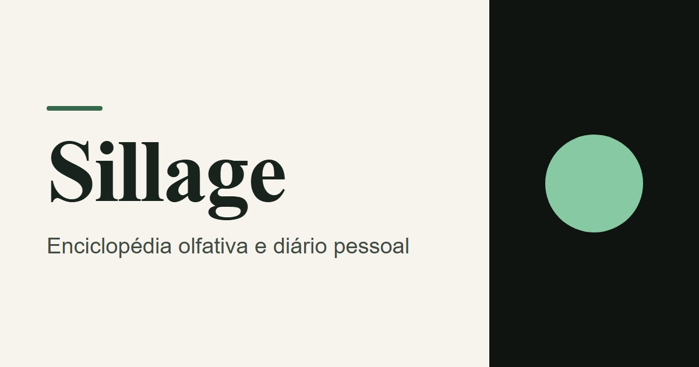
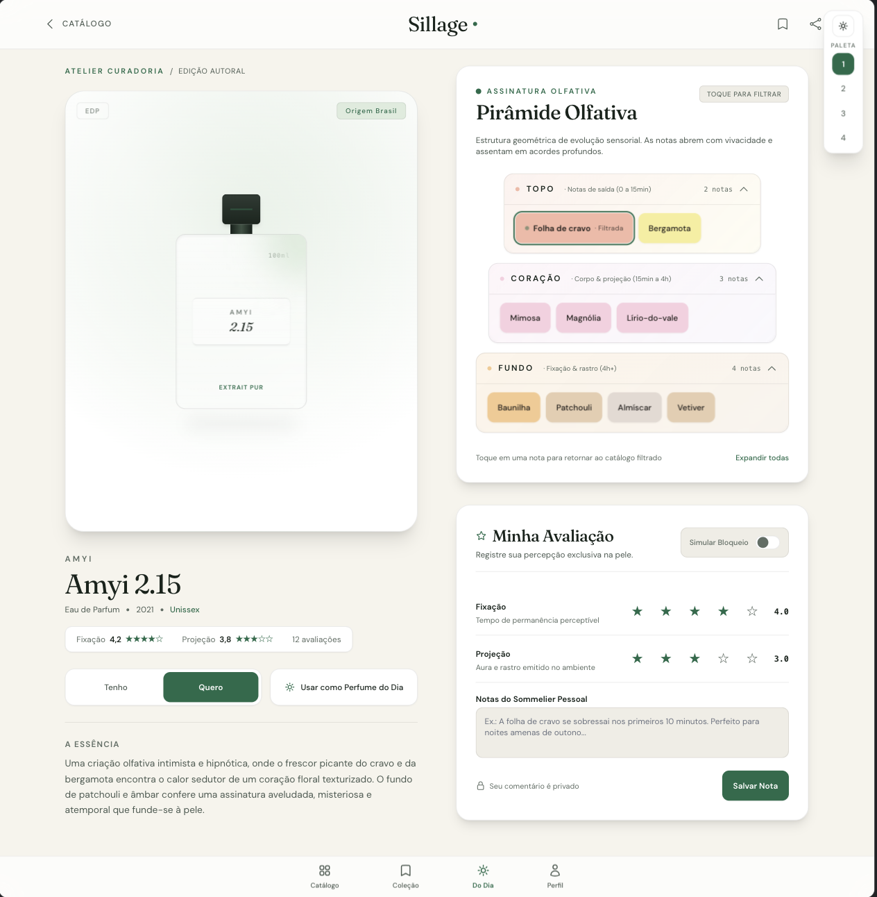
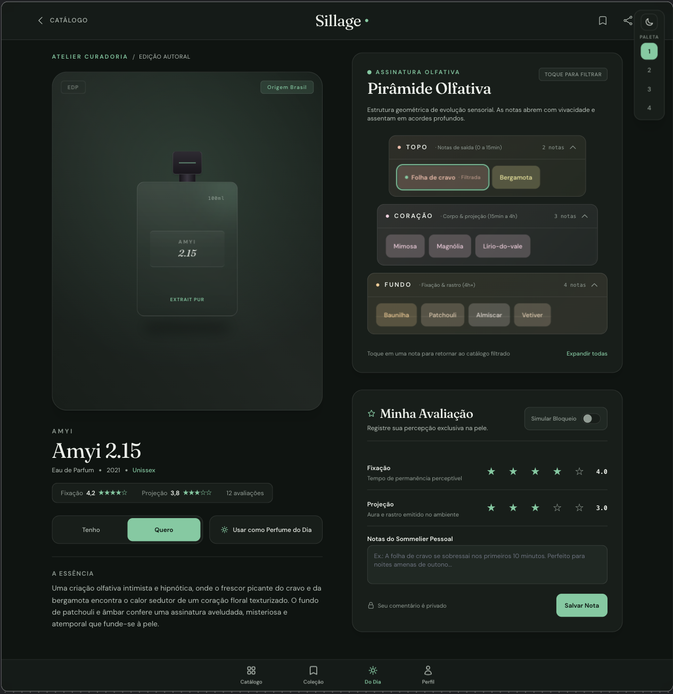
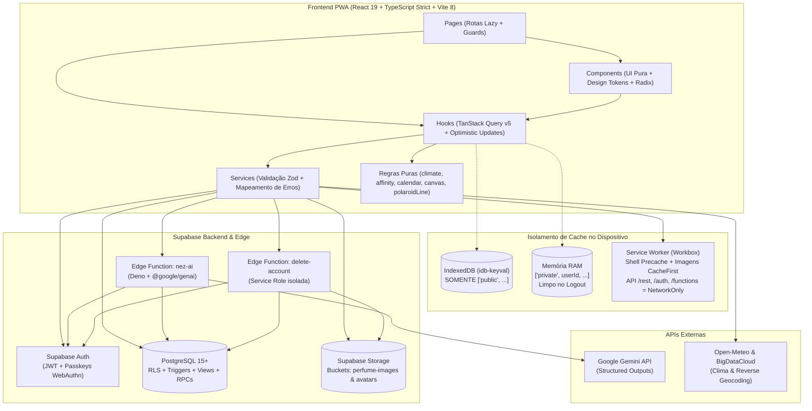
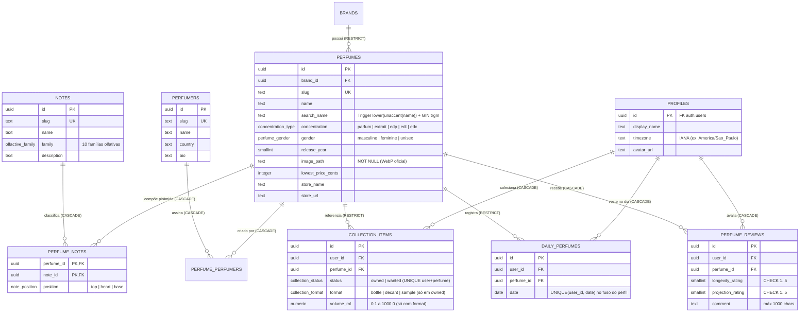
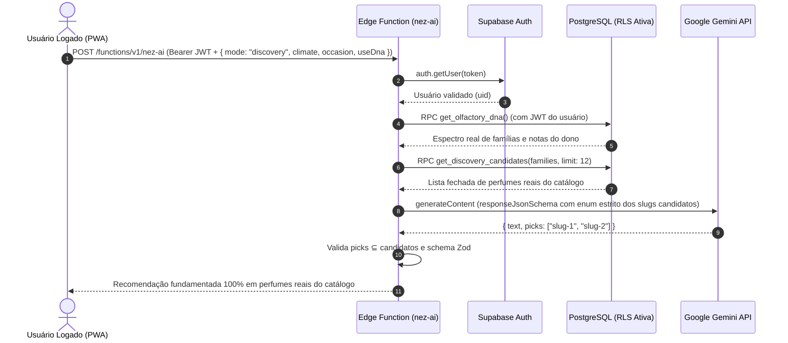

<div align="center">
  

  <h1>Sillage</h1>
  <p><strong>Enciclopédia Olfativa, Acervo Pessoal & Consultoria com IA</strong></p>
  <p>
    <em>"Todo perfume deixa um rastro. O seu começa aqui."</em>
  </p>

  <p>
    
    
    
    
    
    
    
  </p>
  <p>
    
    
    
    
    
  </p>

  <br />
  
</div>

---

## 📖 Visão Geral

O **Sillage** é uma Progressive Web App (PWA) _mobile-first_ de perfumaria de nicho e autoral em português (`pt-BR`), projetada como um case de engenharia _full-stack_ de nível produção.

Mais do que um catálogo visual, o projeto demonstra como construir uma aplicação onde **100% das regras críticas de negócio, privacidade e autorização são garantidas no banco de dados (PostgreSQL + Row Level Security)**, acompanhada por um **Design System próprio (Verde Folha)** validado automaticamente contra diretrizes **WCAG AA**, suporte **Offline-First com isolamento criptográfico/lógico de cache** e **Inteligência Artificial generativa livre de alucinação de catálogo**.

---

## 🎨 Direção de Arte & Interface (Claro ⇄ Escuro)

A identidade visual do Sillage combina tipografia editorial (**Fraunces** nos títulos e **Inter** no corpo), superfícies em papel creme (`#F6F4ED`) e verde-folha profundo (`#36694C`), modo noturno completo (`#0F1411`), _glassmorphism_ controlado e animações físicas em `motion/react` (restritas a `transform` e `opacity`, com suporte nativo a `prefers-reduced-motion`).

|                                     Modo Claro (Verde Folha Editorial)                                      |                                             Modo Escuro (Noturno)                                             |
| :---------------------------------------------------------------------------------------------------------: | :-----------------------------------------------------------------------------------------------------------: |
|  |  |
|       _Palco radial neutro para frascos recortados, pirâmide olfativa interativa e fichas de notas._        |    _Contraste calibrado matematicamente (`npm run check:contrast`) e chips de família translúcidos (22%)._    |

<div align="center">
  
  <p><em>Arte autoral empacotada em WebP responsivo (640w/960w/1200w) no painel de autenticação, servida apenas a partir de <code>md</code> para não disputar LCP no mobile.</em></p>
</div>

---

## ✨ Funcionalidades de Ponta a Ponta

### 1. Catálogo Pesquisável & "Os Narizes" (Perfumistas)

- **Busca tolerante a acentos e erros de digitação:** Motor em PL/pgSQL (`search_perfumes`) combinando `unaccent`, trigramas (`pg_trgm`) com índice invertido **GIN** e correspondência literal de infixo.
- **Filtros multidimensionais combinados na URL:** Marca, família olfativa (10 famílias), notas específicas, posição na pirâmide (Topo, Coração, Fundo), concentração (`Parfum`, `Extrait`, `EDP`, `EDT`, `EDC`), gênero e faixa de ano.
- **Páginas dedicadas de Perfumistas (`/perfumers/:slug`):** Relacionamento N:N (`perfume_perfumers`) com crédito ordenado, país, biografia editorial e acervo de criações.

### 2. Pirâmide Olfativa Interativa, Afinidade & Comparador Lado a Lado

- **Pirâmide em camadas (`OlfactoryPyramid`):** Visualização geométrica interativa de Topo, Coração e Fundo, barra proporcional de famílias (`FamilyBar`) e modal/gaveta de detalhes de cada nota (`NoteSheet`).
- **"Combina com você?" (`PerfumeAffinity`):** Heurística editorial determinística que cruza as notas do perfume com o **DNA Olfativo** do usuário, classificando em _Afinidade alta, média ou baixa_, explicando os motivos em linguagem natural e sugerindo provar num _decant_ quando apropriado.
- **Comparador (`/compare?a=...&b=...`):** Duas colunas sincronizadas (inclusive a `360px` de largura) comparando pirâmide, famílias, fixação, projeção, adequação ao clima de hoje, melhor preço verificado e afinidade pessoal.

### 3. Curadoria Climática em Tempo Real & Perfume do Dia (SOTD)

- **Clima em Tempo Real (`WeatherBar`):** Integração com **Open-Meteo** e geocodificação reversa com privacidade preservada (coordenadas truncadas em 2 casas decimais). Calcula a faixa térmica e destaca as famílias com _Sillage ótima_ para o clima atual.
- **Sugestão Estável do Dia (`RN10`):** Alternância entre **Catálogo** e **Meu armário** (perfumes que o usuário já possui em _"Tenho"_, filtrando os já vestidos nos últimos 3 dias), escolhida via hash determinístico **FNV-1a de 32 bits** sobre a data civil no fuso do usuário.
- **Card Compartilhável 9:16 (`sotdCanvas`):** Geração local em HTML5 `<canvas>` (`1080×1920`) lendo os tokens CSS em tempo de execução, com foto do frasco, notas por camada, clima e compartilhamento via Web Share API.

### 4. Acervo Pessoal (`Tenho` / `Quero`), Memorial em Varal & Retrospectiva Anual

- **Formatos e Volumes (`RN11`):** Itens em _"Tenho"_ suportam detalhamento de **Frasco**, **Decant** ou **Amostra** e volume em `ml` (validados por `CHECK` constraints no PostgreSQL que limpam automaticamente os metadados caso o item migre para _"Quero"_).
- **Memorial em Dupla Visão (`/memorial`):**
  - **Calendário Mensal:** Grade civil no fuso horário do usuário com miniaturas dos perfumes usados em cada dia.
  - **Varal de Memórias (`PolaroidLineCarousel`):** Fotografias polaroid presas num fio com física de catenária e pêndulo a cada quadro (`requestAnimationFrame`), navegável por arraste, toque ou teclado.
- **"Seu Ano em Perfumes" (`/recap/:year`):** Retrospectiva anual em 5 lâminas animadas + card `1080×1920` gerado em canvas, consolidando dias vestidos, consistência, perfume assinatura, favoritos por estação (hemisfério Sul), nota mais presente e evolução de gosto entre o 1º e o 2º semestre (`get_annual_recap`).

### 5. Consultor Olfativo "Nez" (IA com Gemini) & Trilha de Descoberta

- **Modo Chat Contextual:** Gaveta acessível de qualquer tela que injeta o contexto do perfume atual (notas e famílias) e mantém histórico enxuto da conversa.
- **Trilha de Descoberta Guiada (Zero Alucinação):** O usuário escolhe Clima, Ocasião e Preferências (ou seu próprio DNA Olfativo). A Edge Function `nez-ai` consulta o DNA diretamente no banco via JWT, pré-seleciona ~12 candidatos reais via RPC (`get_discovery_candidates`), restringe o Gemini via `responseJsonSchema` (enum estrito dos slugs candidatos) e valida no servidor que `picks ⊆ candidatos` antes de responder.

### 6. Perfil, DNA Olfativo & Autenticação Biométrica (Passkeys)

- **DNA Olfativo (`get_olfactory_dna`):** Função SQL que pondera os perfumes do acervo (`Tenho`) e a frequência de uso no Memorial para traçar o espectro de famílias do usuário, as 3 notas assinatura e a tendência da lista de desejos (`Quero`).
- **Passkeys / WebAuthn (`Face ID` / `Digital`):** Login sem senha e gerenciador completo de dispositivos biométricos no Perfil.
- **Exclusão de Conta com Cascata Total:** Edge Function `delete-account` que valida o JWT, limpa o avatar no Storage e executa `auth.admin.deleteUser()`, disparando `ON DELETE CASCADE` em todas as tabelas privadas.

---

## 🏛️ Arquitetura do Sistema

O projeto segue uma separação estrita em camadas unidirecionais. **Nenhum componente visual contém regras de negócio ou importa o cliente do Supabase.**



---

## 🗄️ Modelo de Dados (PostgreSQL)

Toda a modelagem vive em `supabase/migrations/` (20+ migrations reproduzíveis via `npm run db:reset`).



### Funções RPC e Triggers no Banco (`search_path = ''`)

| Função SQL                      | Tipo               | Responsabilidade                                                                                                                                              |
| :------------------------------ | :----------------- | :------------------------------------------------------------------------------------------------------------------------------------------------------------ |
| `search_perfumes(...)`          | `SECURITY INVOKER` | Busca acento-insensível (`pg_trgm` + `unaccent`), filtros combinados por notas/posição/família/marca/ano e ordenação.                                         |
| `set_daily_perfume(uuid)`       | `SECURITY DEFINER` | Único ponto de escrita em `daily_perfumes`. Exige `status = 'owned'` em `collection_items` (`RN06`) e calcula a data civil no `profiles.timezone` do usuário. |
| `get_olfactory_dna()`           | `SECURITY INVOKER` | Calcula os pesos das famílias olfativas, as 3 notas mais frequentes e a direção da lista de desejos (`Tenho` + `Memorial`).                                   |
| `get_annual_recap(int)`         | `SECURITY INVOKER` | Agrega estatísticas anuais, consistência no fuso do usuário, perfume por estação do hemisfério Sul e evolução semestral.                                      |
| `get_similar_perfumes(...)`     | `SECURITY INVOKER` | Ranking de fragrâncias com maior interseção de notas na pirâmide (`RN09`).                                                                                    |
| `get_discovery_candidates(...)` | `SECURITY INVOKER` | Pré-seleciona candidatos reais do catálogo para blindar a Trilha de Descoberta do Nez contra alucinações.                                                     |

---

## 🔒 Segurança Defensiva & Regras de Negócio (RN01–RN11)

Nenhuma regra de negócio confia apenas na interface. Todas as garantias são auditadas por testes automatizados **pgTAP** rodando como roles reais (`anon` e `authenticated` com claims JWT simulados, nunca como superusuário).



### Matriz de Garantias no Banco de Dados

| Código   | Regra de Negócio                             | Mecanismo de Garantia no Backend                                                                                                                                                                       |
| :------- | :------------------------------------------- | :----------------------------------------------------------------------------------------------------------------------------------------------------------------------------------------------------- |
| **RN01** | **Privacidade Estrita**                      | RLS `(select auth.uid()) = user_id` em `profiles`, `collection_items` e `daily_perfumes`.                                                                                                              |
| **RN02** | **Coleção Única**                            | Constraint `UNIQUE(user_id, perfume_id)` + transição atômica entre `owned` e `wanted`.                                                                                                                 |
| **RN03** | **Avaliação Autorizada**                     | Policy de `INSERT` com `EXISTS` exigindo que o usuário tenha o perfume em `owned` ou já o tenha usado em `daily_perfumes`.                                                                             |
| **RN04** | **Avaliação Única & Imutabilidade de Alvo**  | `UNIQUE(user_id, perfume_id)` + privilégio de `UPDATE` restrito às colunas `longevity_rating`, `projection_rating` e `comment` (impede trocar `perfume_id` após criar para burlar a RN03).             |
| **RN05** | **Ratings de 1 a 5**                         | `CHECK (between 1 and 5)` no PostgreSQL + validação Zod no cliente.                                                                                                                                    |
| **RN06** | **Um Perfume do Dia por Data Civil**         | `REVOKE INSERT, UPDATE` direto em `daily_perfumes`; escrita exclusiva via `set_daily_perfume()`, que valida posse (`owned`) e fuso horário IANA do perfil. Histórico protegido contra `DELETE` avulso. |
| **RN07** | **Proteção Admin contra Escalada**           | Escrita no catálogo exige `is_admin()`, que lê `auth.jwt() -> 'app_metadata' ->> 'role' = 'admin'` (nunca `user_metadata`, que é editável pelo cliente).                                               |
| **RN08** | **Agregados Públicos sem Vazamento de PII**  | Views `perfume_review_stats` e `perfume_reviews_public` expõem médias, comentários e `display_name`, omitindo `user_id`, e-mail e fuso horário no tráfego de rede.                                     |
| **RN09** | **IA sem Chave no Cliente e sem Alucinação** | `GEMINI_API_KEY` exclusiva do runtime Deno; validação de JWT com `auth.getUser()`; interseção obrigatória com `get_discovery_candidates`.                                                              |
| **RN10** | **Curadoria Climática Determinística**       | Regras puras em `src/lib/climate.ts` e `src/lib/closetSuggestion.ts` com sorteio estável por data via hash FNV-1a.                                                                                     |
| **RN11** | **Formato e Volume exclusivos de "Tenho"**   | `CHECK` constraints `collection_items_format_owned_only` e `collection_items_volume_valid` no PostgreSQL.                                                                                              |

---

## 🧪 Qualidade, Testes e Pipeline de CI/CD

O repositório conta com uma pirâmide completa de verificação automatizada (`.github/workflows/ci.yml` e `lighthouse.yml`):

1. **Testes de Banco e Segurança (`pgTAP` — `supabase/tests/database/`):**
   - 20 suítes SQL testando todas as tabelas, constraints, funções RPC, views públicas e tentativas de violação de RLS entre usuários A e B.
2. **Testes Unitários e de Componentes (`Vitest` + `Testing Library`):**
   - Cobertura de todas as funções puras (`climate`, `affinity`, `olfactoryDna`, `calendar`, `polaroidLine`, `sotdCanvas`, `recapCanvas`, `passwordStrength`), hooks, services e componentes de tela.
   - **Guardiões de Design System:** `src/components/no-loose-values.test.ts` falha se qualquer componente em `src/components/**` usar cores literais (`#hex`, `rgb()`, `hsl()`, `oklch()`) fora de `tokens.css`, e `npm run check:contrast` audita matematicamente todos os pares de tokens contra **WCAG AA (4,5:1 texto / 3:1 UI)**.
3. **Testes End-to-End Multi-Dispositivo (`Playwright` + `@axe-core/playwright`):**
   - Rodam contra o build real de produção (`vite preview`) nos projetos: _Desktop Chromium (1280×800)_, _Android (Pixel 7)_, _iPhone 14 (WebKit)_, _Mobile Pequeno (360×780)_, _Tablet (iPad Mini)_, _Firefox_ e _WebKit_.
   - Auditoria **axe-core** em cada fluxo, nos temas Claro e Escuro, verificando ausência de rolagem horizontal a `360px` e medição de contraste pixel a pixel sobre imagens.
4. **Performance & Bundle Splitting (`Lighthouse CI` + `Rolldown`):**
   - Code-splitting cirúrgico (`vendor-react`, `vendor-router`, `vendor-supabase`, `vendor-query`, `vendor-forms`, `vendor-radix`), preload das fontes críticas e rotas privadas com `React.lazy()`.

---

## 📂 Estrutura do Repositório

```text
sillage/
├── docs/                       # Documentação viva (PRODUCT, ARCHITECTURE, DATABASE, SECURITY, DESIGN_SYSTEM, ROADMAP_V2)
├── e2e/                        # Suíte End-to-End Playwright + auditorias WCAG axe-core + fixtures offline/mock
├── public/                     # Ícones PWA, sitemap, robots.txt, og-image.jpg e arte responsiva (auth-art/*.webp)
├── scripts/                    # Pipeline de imagens (sharp flood-fill + WebP), ingestão com Gemini AI e auditoria WCAG
├── src/
│   ├── components/             # Componentes divididos por domínio (ui, layout, auth, home, perfume, collection, daily, compare, nez, recap, profile)
│   ├── constants/              # Limiares editoriais (climate, affinity, dna, collection) e mensagens amigáveis (errors.ts)
│   ├── contexts/               # AuthContext, ThemeProvider e NezContext
│   ├── hooks/                  # Hooks de domínio com TanStack Query, mutações otimistas e suporte offline
│   ├── lib/                    # Funções puras testadas (canvas SOTD/Recap, física do varal, FNV-1a, persistência seletiva)
│   ├── pages/                  # Páginas da aplicação (Landing, Home, Catalog, PerfumeDetails, PerfumerDetails, Compare, Collection, Memorial, Recap, Profile)
│   ├── routes/                 # Data Router + guardas de acesso (RootEntry, RequireAuth, GuestOnly)
│   ├── schemas/                # Validação estrita com Zod (auth, reviews, dna, recap, compare, collectionDetails)
│   ├── services/               # Única camada que comunica com o Supabase e APIs externas
│   └── styles/                 # tokens.css (Fonte da verdade do Design System) e globals.css
└── supabase/
    ├── functions/              # Edge Functions em Deno (nez-ai, delete-account e _shared/cors.ts)
    ├── migrations/             # Schema SQL evolutivo, funções PL/pgSQL, triggers, views e policies de RLS
    ├── tests/database/         # 20 arquivos de testes pgTAP para validação de banco e segurança
    └── seed.sql                # Catálogo curado inicial (marcas, perfumes, notas e pirâmides completas)
```

---

## 🚀 Como Executar Localmente

### Pré-requisitos

- **Node.js** `>= 22.12.0` (ou `^20.19.0`)
- **Docker Desktop** (em execução, para subir a stack local do Supabase)

### Passo a passo

```bash
# 1. Clone o repositório e instale as dependências
git clone https://github.com/snoopyjmX/sillage.git
cd sillage
npm install

# 2. Suba o banco de dados local (PostgreSQL, Auth, Storage e Edge Runtime via Docker)
# Isso aplica automaticamente todas as migrations e popula o catálogo inicial (seed.sql)
npm run db:start

# 3. Configure as variáveis de ambiente locais
cp .env.example .env.local
# Copie a API URL e a anon key exibidas pelo comando `npm run db:start` para o seu .env.local

# 4. Inicie o servidor de desenvolvimento
npm run dev
```

Acesse `http://localhost:5173` no navegador.

> 💡 **Dica de desenvolvimento:** Acesse `http://localhost:5173/?vitrine` em modo `dev` para abrir a **Vitrine do Design System**, que exibe todos os componentes do Sillage lado a lado nos temas Claro e Escuro.

---

## 🛠️ Scripts Disponíveis

| Comando                      | Descrição                                                                                                 |
| :--------------------------- | :-------------------------------------------------------------------------------------------------------- |
| `npm run dev`                | Inicia o servidor Vite em modo de desenvolvimento.                                                        |
| `npm run build`              | Executa `tsc -b` e gera o build otimizado de produção com Service Worker (PWA).                           |
| `npm run analyze`            | Gera o mapa visual de chunks e pacotes do bundle (`stats.html`).                                          |
| `npm test`                   | Executa toda a suíte de testes unitários e de integração com **Vitest**.                                  |
| `npm run db:test`            | Executa as 20 suítes **pgTAP** direto no PostgreSQL local (`supabase test db`).                           |
| `npm run e2e`                | Roda a suíte **Playwright** completa + auditorias de acessibilidade **axe-core**.                         |
| `npm run check:contrast`     | Audita matematicamente todos os tokens de cor em `tokens.css` contra **WCAG AA**.                         |
| `npm run lint` / `typecheck` | Valida regras de ESLint, TypeScript strict (`--noEmit`) e formatação Prettier.                            |
| `npm run ingest`             | Extrai ficha técnica e pirâmide olfativa com **Gemini AI** + validação Zod e gera migration SQL.          |
| `npm run images`             | Remove o fundo branco dos frascos (`sharp` flood-fill local) e gera variantes WebP `320w`/`640w`/`1280w`. |

---

## 📚 Documentação Técnica Detalhada

Para mergulhar nas decisões de arquitetura, regras de negócio e especificações de segurança, consulte a documentação na pasta [`docs/`](docs/):

- 📄 [**Especificação de Produto (`docs/PRODUCT.md`)**](docs/PRODUCT.md) — Escopo completo, regras `RN01`–`RN11`, heurísticas editoriais e matriz de testes.
- 🏛️ [**Arquitetura (`docs/ARCHITECTURE.md`)**](docs/ARCHITECTURE.md) — Decisões por fase, justificativa de cada dependência, estratégia de cache PWA e fluxo de dados.
- 🗄️ [**Banco de Dados (`docs/DATABASE.md`)**](docs/DATABASE.md) — Catálogo de migrations, tabelas, índices GIN trigram, funções PL/pgSQL e views públicas.
- 🛡️ [**Segurança e Modelo de Ameaça (`docs/SECURITY.md`)**](docs/SECURITY.md) — Políticas de RLS, proteção de JWT, CSP, privacidade de geolocalização e riscos aceitos.
- 🎨 [**Design System (`docs/DESIGN_SYSTEM.md`)**](docs/DESIGN_SYSTEM.md) — Tokens de cor, tipografia, vidro, curvas de animação e inventário completo de componentes.
- 🗺️ [**Roadmap de Evolução V2 (`docs/ROADMAP_V2.md`)**](docs/ROADMAP_V2.md) — Perfumistas, Trilha de Descoberta do Nez, Retrospectiva Anual e pipeline de ingestão.

---

## 👨‍💻 Autor

Desenvolvido por **João Marcelo Sousa Garcês de Araújo**.

[](https://www.linkedin.com/in/joãomarcelos/)
[](https://github.com/snoopyjmX)
