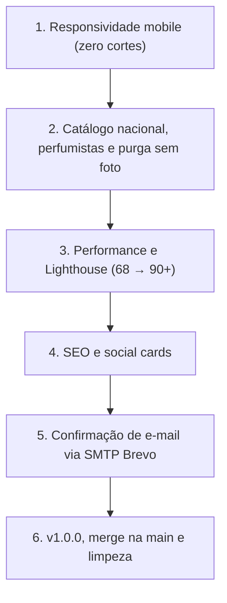

# Sillage — Plano de Entrega Final v1.0.0

Especificação para fechar a versão 1.0.0 do **Sillage**. Ajustada ao estado real do código em 14/10/2026: cada fase indica o que já existe, o que falta e como validar.

**Decisões tomadas:**

- **SMTP:** Brevo (conta já criada). Não temos domínio próprio, então o Resend não serve: sem domínio verificado, ele só entrega no e-mail do dono da conta.
- **Perfumistas:** cadastrar todos os nove da lista, inclusive quem ainda não assina nenhum perfume do catálogo.
- **Purga sem foto:** `perfumes.image_path` passa a ser `NOT NULL` no banco.

---

## 1. Visão geral



Tudo acontece na branch `release/v1.0.0`, criada a partir da `main`, com um commit por fase. Antes do push, rodar `tsc`, `eslint`, `vitest`, `supabase test db` (pgTAP) e o E2E.

### Correções ao diagnóstico original

| Premissa antiga                                          | Realidade verificada                                                                                                                                                            |
| -------------------------------------------------------- | ------------------------------------------------------------------------------------------------------------------------------------------------------------------------------- |
| Os preloads de fonte do `index.html` dão 404 em produção | Falso: o Vite reescreve o `href` para `/assets/*-<hash>.woff2` (conferido no `dist/index.html`). A causa do 68 precisa ser medida.                                              |
| `sotdCanvas` e `recapCanvas` pesam na Landing            | Não pesam: só os carregam a Home do logado e a `RecapPage`, ambas lazy. O ganho real é deixar o `ShareCardDialog` lazy.                                                         |
| Falta `pb-24` no AppShell para o botão do Nez            | O Footer já reserva `pb-[calc(5rem+env(safe-area-inset-bottom))]`, e o `main` já tem `px-4` (16 px). A colisão acontece durante a rolagem, e padding não a resolve.             |
| Os stubs sem foto estão no seed oficial                  | Estão só em `supabase/dev/fake-perfumes-e2e.sql` (fixture de E2E). Os 20 perfumes do `seed.sql` têm foto.                                                                       |
| Faltam meta tags OG                                      | O `SeoHead` já gera OG e Twitter por rota, mas via JS. Faltam as tags estáticas, que são as que os crawlers leem, e uma imagem própria (hoje usamos `pwa-512x512.png`).         |
| Falta a tela "verifique seu e-mail"                      | Já existe: `authService.signUp` devolve `needsEmailConfirmation` e a `RegisterPage` exibe o aviso, com testes. Faltam SMTP, `emailRedirectTo`, a página de retorno e o reenvio. |

---

## Fase 1: Responsividade mobile (zero cortes)

### 1.1 Diagnóstico

- **Palco do frasco:** em `DailySuggestionCard.tsx` e `DailyHighlight.tsx`, o `PerfumeStage` usa `aspect-[4/3]` no mobile, e a imagem declara 640×640, embora as fotos sejam 4:5.
- **Padding:** `DailyHighlight` usa `p-6 md:p-10`. O `DailySuggestionCard` já usa `p-4 sm:p-6 md:p-8`.
- **NezFab** (`fixed right-6 bottom-[max(1.5rem,…)]`): a pílula com rótulo passa por cima do cabeçalho "Memorial / Ver calendário" durante a rolagem.
- **Cabeçalho do Memorial** (`HomePage.tsx`): já tem `flex-wrap` e 16 px de margem lateral. Falta confirmar visualmente.

### 1.2 Tarefas

1. **Reproduzir antes de corrigir:** tirar screenshots com o Playwright em 360 e 390 px da Home com sugestão e com Perfume do Dia, e registrar onde o título ("Bossa"), as notas e os botões são cortados.
2. **Palco do frasco** (nos dois cards):
   - `PerfumeStage`: trocar `aspect-[4/3]` por `h-48 w-full sm:h-60 md:h-auto md:min-h-80` (sugestão: `md:min-h-96`).
   - Imagem: usar `max-h-full max-w-full object-contain p-3` e `width={640} height={800}`.
   - `DailyHighlight`: padding `p-4 sm:p-6 md:p-10`.
   - Os skeletons (`DailySuggestionSkeleton` e `DailySkeleton.tsx`) seguem as mesmas alturas, para não haver layout shift.
3. **NezFab compacto no mobile:**
   - Abaixo de `sm`: só o ícone, num círculo de 48 px (`size-12`, `right-4`), com `aria-label="Abrir o Nez"`.
   - A partir de `sm`: a pílula atual, com rótulo.
   - Manter a reserva de espaço do Footer.
4. **Memorial a 360 px:** ajustar o cabeçalho só se o screenshot mostrar aperto.
5. **Validação (Playwright):** spec com viewports de 360 e 390 px que verifique:
   - `document.documentElement.scrollWidth <= clientWidth`;
   - o título, as notas e os botões do card ficam dentro da viewport;
   - o NezFab não cobre o link "Ver calendário" na posição de repouso.

---

## Fase 2: Catálogo nacional, perfumistas e purga sem foto

### 2.1 Novos perfumes nacionais

**Fluxo oficial do projeto:**

1. `npm run ingest -- --url <página oficial> --image <url da foto oficial>` gera uma migration idempotente em `supabase/migrations/`.
2. Revisar a migration.
3. `npm run images` (Sharp: recorte transparente, 4:5, três tamanhos, hash e `manifest.json`).
4. `npm run images:upload` (feito pelo mantenedor, com a `service_role` local e fora do front).

Não editar o `seed.sql` à mão.

| Marca       | Perfume         | Situação                                   |
| ----------- | --------------- | ------------------------------------------ |
| Granado     | Nostalgia       | Listado no CATALOGO_REAL, nunca cadastrado |
| Granado     | Époque Tropical | Listado no CATALOGO_REAL, nunca cadastrado |
| Granado     | Carioca         | Novo                                       |
| Natura      | Essencial Oud   | Listado no CATALOGO_REAL, nunca cadastrado |
| Natura      | Homem Cor.Agio  | Novo                                       |
| O Boticário | Elysée          | Listado no CATALOGO_REAL, nunca cadastrado |
| O Boticário | Zaad Santal     | Novo (confirmar que existe na linha Zaad)  |
| Avatim      | Seleto          | Listado no CATALOGO_REAL, nunca cadastrado |

**Regra:** sem página oficial e foto oficial, o perfume fica de fora. A pirâmide olfativa vem da fonte oficial, não da descrição deste plano.

Para a expansão contínua em larga escala, o backlog completo com os ~720 perfumes categorizados por marcas (Granado, O Boticário, Natura, Avatim, In The Box, Maison Viegas, Nuancielo, Chanel, YSL, JPG, Gucci, Calvin Klein) está catalogado em `docs/CATALOGO_EXPANSAO.md`.

Ao terminar, atualizar `docs/CATALOGO_REAL.md`.

### 2.2 Perfumistas

A tabela `perfumers` (migration `20261015120000_perfumers.sql`) já tem as colunas `bio` e `country`, mas foi preenchida só com nome e slug.

1. Uma migration nova faz upsert por `slug` de todos os nove perfumistas, com bio em pt-BR e país:
   - **Nacionais:** Verônica Kato, Eurico Mazzini e Adilson Rato (Brasil).
   - **Globais:** Alberto Morillas (Espanha), Francis Kurkdjian (França), Dominique Ropion (França), Jean-Claude Ellena (França), Quentin Bisch (França) e Isaac Sinclair (Nova Zelândia).
2. As bios trazem só fatos verificáveis. Se não houver fonte para um nome, a bio fica curta e neutra, sem inventar carreira.
3. As ligações em `perfume_perfumers` só entram quando a autoria tem fonte, seja página da marca ou da casa de fragrância.
4. **Perfumista sem perfume no catálogo:** a `PerfumerDetailsPage` precisa de um estado vazio de verdade, em pt-BR, com bio e país visíveis e um link para o catálogo. Cobrir com teste de página.
5. **pgTAP:** os testes atuais de RLS de `perfumers` continuam passando, e entra uma asserção de que nenhum perfumista fica sem `country`.

### 2.3 Purga sem foto (`image_path NOT NULL`)

1. **Medir:** contar em produção os perfumes com `image_path is null`, e quantas entradas de coleção, diário e reviews dependem deles. Decidir o destino desses dados antes de apagar qualquer coisa.
2. **Migration:**
   - apagar os perfumes sem foto; as dependências seguem os `on delete` do schema, a conferir antes;
   - `alter table public.perfumes alter column image_path set not null`.
3. **Testes e scripts:**
   - pgTAP: cobrir que o insert sem `image_path` falha, e ajustar qualquer teste que insira perfume sem foto.
   - Fixtures `supabase/dev/fake-perfumes*.sql`: os stubs (`amyi-2-15`, `irish-green-man`, `caipi-argent`) passam a apontar para uma imagem existente, ou saem se nenhum teste depender deles.
   - `scripts/ingest-perfume.mjs`: recusar a geração sem `--image`.
   - `npm run db:types`: o tipo de `image_path` deixa de aceitar `null`. Revisar os usos de `?? null` e os fallbacks do front.
4. **O `PerfumePlaceholder` continua existindo**, para URL quebrada ou offline.
5. **Docs:** registrar a mudança em `DATABASE.md` e a regra em `PRODUCT.md` (catálogo só com foto oficial).

---

## Fase 3: Performance e Lighthouse (68 → 90+)

1. **Medir primeiro:** rodar o Lighthouse mobile em produção (`https://sillage-ashy-gamma.vercel.app/` e `/login`) e anotar as cinco maiores oportunidades: LCP, JS não usado, preloads sem uso (o Fraunces 600 pode não aparecer na Landing), cache e imagens.
2. **Cache dos assets estáticos** no `vercel.json`: uma entrada própria antes da regra genérica.
   ```json
   {
     "source": "/assets/(.*)",
     "headers": [{ "key": "Cache-Control", "value": "public, max-age=31536000, immutable" }]
   }
   ```
3. **`ShareCardDialog` lazy** no `DailyHighlight`: montar só ao abrir, no mesmo padrão do `CollectionDetailsHost` no `AppShell`. Assim o `sotdCanvas` sai do bundle da Home.
4. **Preloads de fonte:** manter os caminhos atuais (o Vite os reescreve). Remover apenas os que o relatório apontar como não usados.
5. Corrigir os demais pontos que a medição apontar.
6. **Lighthouse CI:** subir o mínimo de performance em `lighthouserc.json` de 0.75 para 0.9 quando três execuções seguidas passarem.
   - **Estado atual (v1.0.0):** performance está como `warn` (mínimo 0.75), porque o runner da CI é compartilhado e o site mede ~0.8 localmente. Acessibilidade, boas práticas e SEO seguem como `error`.

---

## Fase 4: SEO e social cards

Os crawlers do WhatsApp, LinkedIn, Telegram e X não executam JS: leem só o `<head>` estático.

1. **`public/og-image.jpg` (1200×630):**
   - Script `scripts/og-image.mjs` que renderiza um HTML com Fraunces e as cores dos tokens (`--background` e `--foreground` claros e escuros) e tira o screenshot com o Playwright, que já é devDependency.
   - Slogan: "Enciclopédia olfativa e diário pessoal".
   - O script fica no repositório para regenerar a imagem quando quiser.
2. **Tags estáticas no `index.html`**, com URLs absolutas de produção:
   - `<title>Sillage — Enciclopédia olfativa e diário de perfumaria</title>`
   - `description`
   - `og:title`, `og:description`, `og:image` (`https://sillage-ashy-gamma.vercel.app/og-image.jpg`), `og:image:width/height`, `og:url`, `og:type`, `og:site_name`, `og:locale` (`pt_BR`)
   - `twitter:card` (`summary_large_image`), `twitter:title`, `twitter:description`, `twitter:image`
3. **Convivência com o `SeoHead`:** conferir no navegador se o React 19 duplica o `<title>` e as `<meta>`. Se duplicar, o `SeoHead` passa a cuidar só do que muda por rota. O `DEFAULT_IMAGE_PATH` muda para `/og-image.jpg`.
4. **Validar depois do deploy:** opengraph.xyz, LinkedIn Post Inspector e uma prévia no WhatsApp.

---

## Fase 5: Confirmação de e-mail via SMTP Brevo

### 5.1 Brevo

- Plano grátis: 300 e-mails por dia.
- Sem domínio próprio, o remetente é um **sender verificado** (o próprio Gmail). A entregabilidade é menor do que com domínio (pode cair no spam), o que é aceitável para um portfólio. Se surgir um domínio, configurar SPF, DKIM e DMARC no Brevo e trocar o remetente.

### 5.2 Configuração (painel; feita pelo mantenedor)

1. **Brevo** → _Senders, Domains & Dedicated IPs_: verificar o remetente (Gmail).
2. **Brevo** → _SMTP & API_ → _SMTP_: gerar uma **SMTP key** e anotar o login SMTP (formato `xxxx@smtp-brevo.com`).
3. **Supabase** → _Authentication → Emails → SMTP Settings_:
   - Host: `smtp-relay.brevo.com`
   - Porta: `587`
   - Usuário: o login SMTP do Brevo
   - Senha: a SMTP key
   - Sender email: o remetente verificado; Sender name: `Sillage`
4. **Supabase** → _Authentication → Sign In / Providers → Email_: ligar **Confirm email**.
5. **Supabase** → _Rate limits_: ajustar os e-mails por hora para algo compatível com o limite do Brevo (sugestão: 30).
6. **Supabase** → _Email Templates_: traduzir para pt-BR os templates "Confirm signup" e "Reset password", no tom do produto.
7. **Supabase** → _URL Configuration_: conferir se a Site URL é a da Vercel e se `https://sillage-ashy-gamma.vercel.app/**` está nas Redirect URLs.

A SMTP key fica só no painel do Supabase. Nunca vai para o repositório nem para o front.

### 5.3 Código

1. `authService.signUp`: passar `emailRedirectTo: \`${window.location.origin}/auth/confirmed\``.
2. **Rota pública `/auth/confirmed`** (lazy, no `router.tsx`):
   - o supabase-js já lê o token da URL;
   - a página mostra os estados de carregando, sucesso ("Conta confirmada", com link para entrar ou para a Home), link expirado ou inválido (com opção de reenviar) e offline.
3. **Reenviar e-mail:** botão na tela pós-cadastro da `RegisterPage` que chama `supabase.auth.resend({ type: 'signup', email })`. Fluxo: service, hook e componente, com cooldown visível.
4. **Login sem confirmação:** mapear `email_not_confirmed` em `constants/errors.ts`, com uma mensagem que oferece reenviar o link.
5. **Testes:** service (`emailRedirectTo` e `resend`), página `/auth/confirmed` (sucesso e erro) e erro de login não confirmado.
6. **Local:** `enable_confirmations` continua `false` no `supabase/config.toml`, para não quebrar o E2E e o Lighthouse CI.

### 5.4 Docs

- `docs/SECURITY.md`: remover o risco aceito da Fase 15A e registrar a confirmação ligada em produção com SMTP Brevo.
- `docs/ARCHITECTURE.md`: registrar a rota `/auth/confirmed`.

---

## Fase 6: v1.0.0, merge na main e limpeza

### 6.1 Versão

- Mudar o `package.json` de `0.1.1` para `"version": "1.0.0"`. O `Footer.tsx` já renderiza `{__PKG_VERSION__}`, então passa a exibir "Versão 1.0.0" sozinho.

### 6.2 Merge

1. `git checkout -b release/v1.0.0` a partir da `main`, com um commit por fase.
2. `git push -u origin release/v1.0.0`.
3. Abrir o PR para a `main` e esperar o CI e o Lighthouse ficarem verdes. O `gh` não está instalado neste ambiente: ou ele é instalado, ou o PR é aberto pela interface web, com o texto preparado.
4. Depois do merge: tag `v1.0.0` e Release no GitHub, com changelog resumido por fase.

### 6.3 Limpeza

1. **Branches locais:** apagar só as listadas em `git branch --merged main` (`git branch -d`, nunca `-D`).
2. **Branches remotas e PRs antigos do dependabot:** listar primeiro e apagar com confirmação explícita do mantenedor. Os PRs de actions v7 já estão obsoletos, porque o CI já usa v7.
3. **Dependabot:** em vez de pausar, usar `interval: 'monthly'` e `open-pull-requests-limit: 3` nos dois ecossistemas.
4. **Workflow runs com falha:** limpar pela interface do Actions ou pela API (manual).
5. **README:** atualizar badges, prints dos frascos novos, seção de arquitetura e instruções de setup (incluindo o SMTP).
6. **Docs:** marcar o plano como concluído em `HANDOFF.md` e `ROADMAP_V2.md`.

---

## Checklist de pronto

- [ ] Zero overflow horizontal e zero corte em 360 e 390 px (E2E)
- [ ] Todo perfume do catálogo tem foto; `image_path NOT NULL` com teste pgTAP
- [ ] Nove perfumistas com bio e país; a página de perfumista sem perfumes tem estado vazio
- [ ] Lighthouse mobile ≥ 90 em performance, acessibilidade, boas práticas e SEO
- [ ] Prévia do link correta no WhatsApp e no LinkedIn
- [ ] Cadastro em produção envia e-mail pelo Brevo; confirmação, reenvio e link expirado funcionam
- [ ] `tsc`, `eslint`, `vitest`, pgTAP e E2E verdes; nenhuma policy de RLS enfraquecida
- [ ] Footer mostra "Versão 1.0.0"; Release `v1.0.0` publicada
