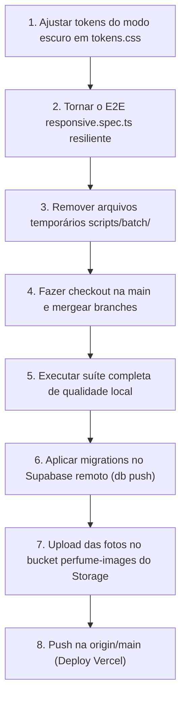

# Sillage — Plano Mestre de Consolidação, Modo Noturno, Limpeza e Deploy

Este documento detalha o plano final de entrega para o **Sillage**, consolidando as branches abertas, padronizando a exibição dos frascos no modo noturno, purgando stubs sem foto no banco remoto, fazendo o upload dos novos assets para o Supabase Storage, limpando arquivos temporários e preparando o repositório para o deploy de produção na Vercel.

---

## 1. Diagnóstico do Estado Atual

### 1.1 Branches e Recursos Pendentes

- **`fix/mobile-stage-contain`:** Corrige a sobreposição do frasco nos cards mobile (`PerfumeStage` com `flex` e `overflow-hidden`, `PerfumeImage` com `size-full object-contain p-3`). Possui uma fragilidade no teste E2E `e2e/responsive.spec.ts` em 360 px, onde a asserção `getByRole('img')` falha quando o perfume sugerido entra em fallback com `PerfumePlaceholder` (`aria-hidden`).
- **`feat/ui-checkbox-password-strength`:** Implementa o componente de acessibilidade `Checkbox` e o medidor de força de senha (`PasswordStrength`), devidamente testados e documentados.
- **`fix/mobile-stage-overlap`:** Contém as migrations de catálogo em lote (`20261020120003` a `20261020120008`) e os JSONs de dados das marcas Granado, Natura, O Boticário, In The Box, Maison Viegas, Nuancielo e JPG, além de perfis de perfumistas em massa.
- **`main`:** Contém a versão v1.0.0 estável e a autenticação biométrica com passkeys (Fase 25).

### 1.2 Modo Noturno das Fotos

- Em `src/styles/tokens.css`, a classe `.dark` definia `--stage: #272e29` e `--stage-highlight: #36403a`.
- Como as fotografias dos frascos foram capturadas e recortadas sobre fundos claros, a exibição sobre um fundo escuro cria a percepção errônea de um "filtro noturno" ou manchas nas bordas.
- **Decisão:** No bloco `.dark`, `--stage` e `--stage-highlight` devem manter os valores idênticos ao `:root` (`#efece3` e `#fbfaf6`). O palco do frasco permanece neutro e claro, exatamente como no tema claro.

### 1.3 Banco Remoto (Supabase) e Purga de Stubs

- Foi realizada auditoria no banco remoto de produção: existem exatamente 3 perfumes sem foto (`caipi-argent`, `amyi-2-15` e `irish-green-man`).
- Nenhum usuário possui dados atrelados a esses 3 perfumes (0 itens de coleção, 0 reviews, 0 registros de perfume do dia).
- A migration `20261019120000_perfumes_image_required.sql` já possui a deleção desses stubs e aplica `ALTER TABLE perfumes ALTER COLUMN image_path SET NOT NULL;`.
- A aplicação via `supabase db push` purgará os 3 stubs com total segurança e aplicará os novos lotes de catálogo.

### 1.4 Supabase Storage (Assets)

- O arquivo `scripts/processed-images/manifest.json` já cataloga 96 fotos processadas e otimizadas em WebP com hash e variantes (`thumb`, `medium`, `large`).
- Para que as imagens sejam servidas em produção, o script `scripts/upload-images.mjs` deve ser executado apontando para o ambiente remoto com a flag `ALLOW_REMOTE_UPLOAD=1`.

---

## 2. Mapa do Fluxo de Execução



---

## 3. Tarefas Detalhadas

### Tarefa 1: Padronização Visual do Palco dos Frascos no Modo Noturno

- **Arquivo:** `src/styles/tokens.css`
- **Ação:** Dentro da regra `.dark`, alterar os tokens do palco para os valores claros do `:root`:
  ```css
  --stage: #efece3;
  --stage-highlight: #fbfaf6;
  ```
- **Resultado:** O frasco mantém o mesmo fundo suave e a mesma fidelidade de cor em ambos os modos.

### Tarefa 2: Resiliência do Teste E2E Mobile

- **Arquivo:** `e2e/responsive.spec.ts`
- **Ação:** No helper `expectBottleAboveHeading`, verificar a geometria do contêiner `[data-slot="perfume-stage"]`. Se houver elemento `img` dentro dele, assegurar que sua borda inferior não ultrapasse o topo do cabeçalho:
  ```ts
  const expectBottleAboveHeading = async (card: Locator, heading: Locator) => {
    const stage = card.locator('[data-slot="perfume-stage"]');
    const [stageBox, headingBox] = [await stage.boundingBox(), await heading.boundingBox()];
    expect(stageBox).not.toBeNull();
    expect(headingBox).not.toBeNull();
    expect(stageBox!.y + stageBox!.height).toBeLessThanOrEqual(headingBox!.y);

    const bottle = stage.locator('img');
    const bottleBox = await bottle.boundingBox();
    if (bottleBox) {
      expect(bottleBox.y + bottleBox.height).toBeLessThanOrEqual(headingBox.y);
    }
  };
  ```

### Tarefa 3: Limpeza de Artefatos Temporários

- **Ação:** Excluir a pasta `scripts/batch/` que contém arquivos de log e depuração gerados pelos scripts de ingestão (`erros-ingest.json`, `fotos_novas.json`, etc.).
- Preservar apenas as bases oficiais e revisadas em `scripts/catalog-data/`.

### Tarefa 4: Unificação e Limpeza do Git

- **Ação:** Na branch `main`, incorporar via merge:
  1. `feat/ui-checkbox-password-strength`
  2. `fix/mobile-stage-contain`
  3. Alterações de catálogo de `fix/mobile-stage-overlap`
- Excluir branches locais que foram incorporadas (`git branch -d`).

### Tarefa 5: Validação da Suíte de Qualidade

Executar localmente e validar que todos os passos estão verdes:

- `npm run format:check`
- `npm run lint`
- `npm run typecheck`
- `npm run test` (todos os 1185 testes unitários)
- `npx playwright test e2e/responsive.spec.ts`
- `npm run build`

---

## 4. Procedimento de Produção (Passo a Passo Manual)

### Passo 1: Atualização do Banco Remoto

Executar no terminal para purgar os stubs sem foto e registrar os novos perfumes e perfumistas:

```powershell
npx supabase db push
```

### Passo 2: Upload das Fotos para o Storage de Produção

Executar o upload das variantes otimizadas de imagens com hash para o bucket `perfume-images`:

```powershell
$env:ALLOW_REMOTE_UPLOAD="1"
node scripts/upload-images.mjs
```

### Passo 3: Deploy na Vercel

Enviar a branch `main` consolidada para o repositório remoto:

```powershell
git push origin main
```

A Vercel iniciará o build de produção imediatamente a partir do webhook da branch `main`.

---

## 5. Prompt para Execução no Claude Code

````markdown
# Tarefa: Consolidação Final, Modo Noturno, Limpeza e Preparação para Deploy

## Contexto

O projeto Sillage concluiu suas fases prioritárias (v1.0.0, passkeys, responsividade mobile, medidor de força de senha, catálogo expandido e perfumistas). Agora precisamos consolidar todas as branches na `main`, padronizar os frascos no modo noturno para ficarem idênticos ao modo claro, expurgar perfumes sem foto no banco remoto, limpar arquivos temporários e deixar o repositório pronto para o deploy final na Vercel.

## Divergências encontradas na spec

Nenhuma encontrada. A regra de negócio RN07 e a migration `20261019120000` exigem `image_path NOT NULL` (nenhum perfume sem foto entra no catálogo). O design system prevê palco neutro para frascos sem distorção cromática.

## Instrução Inicial

Primeiro INSPECIONE o estado atual dos seguintes arquivos e me resuma antes de mexer:

- `src/styles/tokens.css`
- `e2e/responsive.spec.ts`
- `scripts/batch/`
- Histórico de branches: `git branch -v`

---

## Tarefas

### Tarefa 1: Padronizar o palco do frasco no modo noturno (`tokens.css`)

1. Em `src/styles/tokens.css`, dentro do bloco `.dark`, atualize as variáveis `--stage` e `--stage-highlight` para usarem os mesmos tons suaves do tema claro:
   ```css
   --stage: #efece3;
   --stage-highlight: #fbfaf6;
   ```
````

2. Garantir que não haja classes utilitárias ou filtros de inversão de imagem forçados no modo escuro. O frasco deve ter o mesmo aspecto limpo e natural tanto no tema claro quanto no escuro.

### Tarefa 2: Ajustar asserção de teste em `e2e/responsive.spec.ts`

1. Em `e2e/responsive.spec.ts`, atualizar o helper `expectBottleAboveHeading` para testar a caixa delimitadora do palco `[data-slot="perfume-stage"]` em relação ao título, e também a imagem (caso não esteja em fallback de placeholder):
   ```ts
   const expectBottleAboveHeading = async (card: Locator, heading: Locator) => {
     const stage = card.locator('[data-slot="perfume-stage"]');
     const [stageBox, headingBox] = [await stage.boundingBox(), await heading.boundingBox()];
     expect(stageBox).not.toBeNull();
     expect(headingBox).not.toBeNull();
     expect(stageBox!.y + stageBox!.height).toBeLessThanOrEqual(headingBox!.y);

     const bottle = stage.locator('img');
     const bottleBox = await bottle.boundingBox();
     if (bottleBox) {
       expect(bottleBox.y + bottleBox.height).toBeLessThanOrEqual(headingBox.y);
     }
   };
   ```
2. Atualizar as chamadas no arquivo passando o `card` (ex.: `highlight` ou `suggestion`) e o `heading`.
3. Rodar `npx playwright test e2e/responsive.spec.ts` e garantir 100% dos testes passando em 360 px e 390 px.

### Tarefa 3: Limpeza de código morto e arquivos temporários

1. Remover da árvore de arquivos rastreados a pasta `scripts/batch/` (arquivos temporários gerados durante o script de lote).
2. Manter apenas os JSONs oficiais curados em `scripts/catalog-data/`.
3. Confirmar que não há arquivos soltos ou stubs temporários sem uso.

### Tarefa 4: Unificação e Merge na Branch `main`

1. Fazer o checkout da branch `main`.
2. Fazer o merge das alterações:
   - `feat/ui-checkbox-password-strength`
   - `fix/mobile-stage-contain`
   - As migrations e dados de catálogo novo (`20261020120001` até `20261020120008` e `scripts/catalog-data/`)
3. Apagar localmente as branches que já foram incorporadas (`git branch -d`).

### Tarefa 5: Verificação Completa da Suíte de Qualidade

Execute e exiba a saída completa dos seguintes comandos:

1. `npm run format:check`
2. `npm run lint`
3. `npm run typecheck`
4. `npm run test`
5. `npx playwright test e2e/responsive.spec.ts`
6. `npm run build`

Ao término, apresente os resultados para aprovarmos o envio ao GitHub, Supabase remoto e Vercel.

```

```
