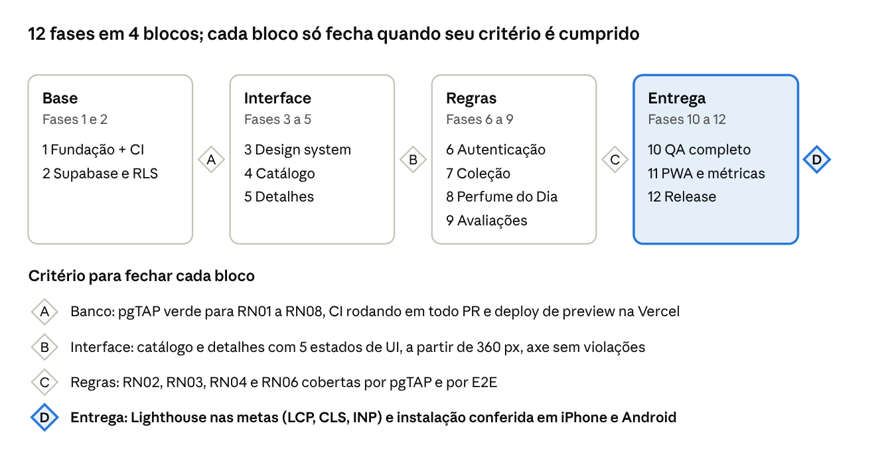

# Sillage — Especificação v1.3

Oct 4, 2026 · @João Marcelo

## 1. Visão geral e o que mudou na v1.2 e na v1.3

PWA de catálogo e coleção de perfumaria de nicho, em português (BR), mobile-first, feito como case de portfólio full-stack: UI premium com animações, regras de negócio garantidas no banco e QA automatizado.

**Objetivos**

1.  Catálogo pesquisável com filtros por nota, posição da nota, família, marca e concentração.

2.  Página do perfume com pirâmide olfativa interativa.

3.  Conta de usuário com coleção (Tenho / Quero), Perfume do Dia com histórico e avaliações de fixação e projeção.

4.  Privacidade real: dados privados protegidos por RLS, nunca só pelo frontend.

5.  PWA instalável, com shell offline; quem tem conta consulta o catálogo salvo sem rede. Só a Landing e as telas de acesso abrem sem login (v1.3).

6.  Visual de perfumaria de nicho (minimalista, luxuoso), consistente porque nasce de um design system e não de componentes soltos.

**Mudanças em relação à v1.0**

| Mudança                                                               | Por quê                                                                                                                                                  |
| --------------------------------------------------------------------- | -------------------------------------------------------------------------------------------------------------------------------------------------------- |
| RN03 (avaliação autorizada) virou policy SQL com `EXISTS`             | Depende de duas tabelas; um `CHECK` não alcança.                                                                                                         |
| Perfume do Dia só aceita perfume em “Tenho” (Fase 15C)                | Decisão do produto: vestir exige ter o frasco. A função `set_daily_perfume` valida `collection_items.status = 'owned'`.                                  |
| Perfume do Dia é gravado por função no banco, no fuso do usuário      | Evita que um registro às 22h (UTC-3) caia no dia seguinte e quebre a RN06.                                                                               |
| Avaliações públicas por views; tabela segue com RLS de dono (Fase 9)  | Decisão do produto: avaliações como numa rede social. A view expõe só nota, comentário e nome do autor; a escrita continua do dono.                      |
| Perfil passa a ser privado                                            | A v1.0 dizia "informações públicas" na tabela e "privado" na RN01.                                                                                       |
| Admin identificado por `app_metadata` do JWT                          | Define a RN07 sem permitir autopromoção; `user_metadata` é editável pelo usuário.                                                                        |
| Busca por RPC com `unaccent` e `pg_trgm`                              | Combinar nota + posição + família + contagem total fica frágil só com filtros do PostgREST.                                                              |
| Offline: cache persistido apenas de queries públicas, limpo no logout | Resolve o conflito entre offline e privacidade (seção 11).                                                                                               |
| Rotas de esqueci/redefinir senha, callback e 404                      | Faltavam na v1.0; a recuperação de senha não funciona sem elas.                                                                                          |
| shadcn/ui + 21st.dev como origem dos componentes                      | Mesma base (Radix + Tailwind + Motion), com regras de curadoria (seção 10).                                                                              |
| 5 arquivos de IA viram `AGENTS.md` + `DESIGN_SYSTEM.md`               | Menos manutenção, mais efeito sobre o resultado visual (seção 13).                                                                                       |
| CI e deploy na Fase 1, não na 12                                      | Cada fase já nasce com preview e checagens.                                                                                                              |
| Índice de busca normalizado para pg_trgm                              | unaccent() é STABLE e não pode ser usado diretamente em uma expressão de índice; search_name será mantido por trigger e indexado com GIN + pg_trgm.      |
| Histórico do Perfume do Dia protegido contra DELETE direto            | O histórico não pode ser apagado pelo usuário; a função permite apenas substituir o registro do dia atual. Exclusão ocorre somente por cascata da conta. |
| Exclusão de conta via Edge Function protegida                         | auth.admin.deleteUser() exige privilégios administrativos; o service_role fica somente no runtime da função, nunca no frontend.                          |
| Logout preserva cache público e remove apenas dados privados          | Queries privadas são removidas da memória e nunca são persistidas. O cache público persistido permanece, mas sem login nenhuma tela o exibe (v1.3).      |

**Mudanças da v1.3 (Fase 14B: Landing e acesso só com cadastro)**

| Mudança                                                                             | Por quê                                                                                                                                                     |
| ----------------------------------------------------------------------------------- | ----------------------------------------------------------------------------------------------------------------------------------------------------------- |
| Só Landing, login, cadastro e recuperação de senha são públicos                     | Decisão do produto (D1). `/catalog`, `/perfumes/:slug`, `/collection`, `/profile` e o 404 exigem login; visitante vai para `/` com `?redirect=`.            |
| O gate é **só de interface**; RN07 e a RLS ficam como estavam                       | O catálogo segue com leitura pública no banco (a `anon key` já é pública). O gate organiza a experiência; não é barreira de dados (ver `docs/SECURITY.md`). |
| `/` é a Landing para visitante e a Home para logado, na mesma URL                   | O `start_url` do PWA continua `/` (D8). Enquanto a sessão carrega, mostra-se o esqueleto, nunca a Landing.                                                  |
| Lighthouse audita `/`, `/login` e `/register` (mesmas metas)                        | As demais rotas redirecionam para a Landing sem login (D2).                                                                                                 |
| SEO: sitemap só com `/`; `robots.txt` bloqueia as rotas privadas                    | As rotas privadas só redirecionam para a Landing e não têm conteúdo indexável (D1).                                                                         |
| Offline: sem login só a Landing abre; o cache público persistido continua, sem tela | Reescreve o teste "após logout o catálogo continua disponível" (D7).                                                                                        |
| Divergência: `AGENTS.md` citava `docs/QA.md`, que não existe                        | A matriz de testes é a seção 12 deste documento (fonte de verdade); nenhum arquivo novo foi criado.                                                         |

## 2. Escopo do MVP

O MVP entrega seis blocos: catálogo, detalhes, autenticação, coleção, Perfume do Dia e avaliações. Painel administrativo fica de fora, mas o schema e as policies já o suportam (seção 6).

**Catálogo.** Cards com nome, marca, imagem, concentração, ano e famílias olfativas. Busca por nome e marca (sem diferenciar acentos). Filtros: marca, família, nota, posição da nota, concentração, gênero e ano. Ordenação: A-Z, Z-A, mais recentes, mais avaliados e, quando há texto de busca, por relevância.

**Detalhes.** Uma página por slug (`/perfumes/amyi-2-15`) com hero, informações principais, descrição, pirâmide olfativa interativa, média pública de avaliações, estado na coleção, ações de coleção e de Perfume do Dia, e a avaliação do próprio usuário. **"Comparar com…" (Fase 18B):** o botão abre uma busca no catálogo (a mesma `search_perfumes`, a partir de 2 letras, sem o próprio perfume) e leva a `/compare?a=<slug>&b=<slug>`. **Comparador:** rota privada `/compare` com os dois perfumes lado a lado (duas colunas, também a 360 px): cabeçalho (foto, marca, nome, concentração, "Ver detalhes" e "Trocar"), e as linhas **Pirâmide** (notas por camada, em texto), **Famílias** (`FamilyBar`), **Fixação e rastro**, **Clima de hoje** (adequação à temperatura de hoje, ou "Clima indisponível"), **Melhor preço** e **Combina com você?** (afinidade da 18A; "Você já tem" para o que está em "Tenho"; "Seu DNA ainda está se formando" com menos de 3 perfumes). Só dados públicos e o DNA de quem olha; **sem duelos nem votação** (D13). A URL é entrada do usuário: slug passa por Zod e o inválido vira "nenhum"; os dois lados iguais pedem dois perfumes diferentes; slug inexistente mostra o erro naquele lado. Cada lado tem os quatro estados (carregando, vazio com "Escolher perfume", erro com tentar de novo e offline). `robots.txt` bloqueia `/compare`.

**"Combina com você?" (Fase 18A, D12):** bloco calmo, depois da pirâmide, com **"Afinidade alta", "média" ou "baixa"** (sem porcentagem, porque é uma heurística) e até dois motivos ("Divide Amadeirado e Cítrico com a sua coleção", "Tem Cedro, uma das notas que mais aparecem na sua coleção", "Você ainda não tem nada Aquático"). Com afinidade média ou baixa, "Prove num decant antes". Vem do DNA olfativo (16A) e das notas do perfume, sem migration. Com menos de 3 perfumes no DNA (D3), mostra "Seu DNA ainda está se formando" e o progresso, sem rótulo. Não aparece para perfume que a pessoa já tem em "Tenho" nem para perfume sem notas; em "Quero" aparece (ajuda a decidir a compra). Estados: carregando (skeleton), "DNA se formando", erro com tentar de novo e offline.

**Autenticação.** Supabase Auth com cadastro, login, logout, recuperação de senha, sessão persistida, rotas privadas e redirecionamento de volta ao destino original após o login. O cadastro é imediato: a confirmação de e-mail está desativada, inclusive em produção (risco aceito, ver `docs/SECURITY.md`).

**Landing e acesso só com cadastro (v1.3).** Visitante vê apenas a Landing (`/`), o login, o cadastro e a recuperação de senha; todo o resto exige conta. A Landing descreve só o que o produto faz (sem depoimentos nem números inventados), tem dois CTAs sempre visíveis ("Criar conta" e "Entrar") e a assinatura "Enciclopédia olfativa". O gate é de interface: a leitura do catálogo continua pública no banco (RN07). O painel de marca das telas de acesso usa uma arte local (WebP em `public/auth-art/`, só a partir de `md`; ver `docs/DESIGN_SYSTEM.md`), com a frase "Todo perfume deixa um rastro. O seu começa aqui." por cima.

**Coleção.** Cada perfume está em `Tenho` ou `Quero` por usuário, nunca nos dois. Ações: adicionar, remover, alternar estado, listar e filtrar. **Formatos (Fase 17A, RN11):** um perfume em "Tenho" pode ter formato (Frasco, Decant ou Amostra) e volume em ml, ambos opcionais. Marcar "Tenho" continua a um toque e o toast oferece "Detalhar formato"; na aba "Tenho" cada card tem o botão "Detalhar" e, havendo formato, um selo discreto ("Frasco 100 ml"). Sem formato não há selo: não presumimos "Frasco". Volumes sugeridos por formato: Frasco 30, 50, 75, 100 e 200 ml; Decant 2, 5, 10, 15 e 20 ml; Amostra 1, 2 e 3 ml; ou outro valor (até 1.000 ml, uma casa decimal).

**Perfume do Dia.** Um por data, no fuso do usuário, com histórico completo consultável. Escolher de novo no mesmo dia substitui o anterior.

**Home (Fase 14D).** Barra de clima (cidade, temperatura, descrição, frase da faixa, umidade e as famílias em destaque), selo "Edição diária", a **sugestão do dia** (RN10) com imagem, notas por posição e medidores de Fixação, Rastro e Clima adequado, as ações "Vestir hoje" (grava o Perfume do Dia) e "Ver detalhes", "Seu Perfume de hoje", "Memorial" (histórico) e as descobertas: "Novidades no catálogo", "Parecidos com o seu perfume de hoje" e "Explore por família". O clima vem do Open-Meteo, sem backend nosso (seção 11); a Home é só do logado (visitante vê a Landing). **Memorial em calendário (Fase 19):** o Memorial da Home ganhou o link "Ver calendário" para a rota privada `/memorial`: grade mensal (semana de domingo a sábado) com a miniatura do perfume em cada dia registrado, que leva ao perfume; dia sem perfume mostra só o número; o dia de hoje tem destaque e vem identificado em texto ("(hoje)"). Navegação entre meses ("Mês anterior", "Próximo mês" e "Ir para este mês"); o mês fica na URL (`?mes=AAAA-MM`), validado: inválido, anterior a 2000 ou futuro volta para o mês de hoje, e não há como avançar além dele. Abaixo da grade, "N dias registrados em <mês>"; mês sem perfume mostra a grade e o estado vazio com saída para o catálogo. As datas são civis no fuso do perfil, sem conversão. Estados: carregando (grade esqueleto do mesmo tamanho), vazio, erro com tentar de novo e offline. `robots.txt` bloqueia `/memorial`. A retrospectiva compartilhável "Seu ano em perfumes" (reaproveitando o `sotdCanvas`) segue como ideia futura. **Origem da sugestão (Fase 17B):** um seletor em pílula ("Catálogo" e "Meu armário") acima da sugestão; no modo armário o filtro de gênero some, o rótulo vira "Do seu armário · Marca" e "Vestir hoje" já vem habilitado (RN06); "Tenho" vazio mostra "Sua prateleira está vazia". **Card SOTD (Fase 16B):** o destaque "Seu Perfume de hoje" tem o botão "Compartilhar dia", que abre um diálogo com a prévia 9:16 do card, a caixa "Mostrar a cidade" e as ações "Compartilhar" (só onde o navegador compartilha arquivos) e "Baixar imagem".

**Perfil (Fase 14E).** Rota privada `/profile`, dentro do `AppShell`. Cabeçalho com avatar de **iniciais** (primeira letra da primeira e da última palavra do nome, acentos mantidos, emoji ignorado; sem letra, um ícone; com **foto de perfil** (15D) a imagem redonda substitui as iniciais e, se não carregar, elas voltam), nome de exibição, fuso e e-mail, e o botão "Sair". **Resumo** só com dados que já existem: quantos perfumes em "Tenho", quantos em "Quero" e quantos **dias no memorial** (linhas de `daily_perfumes`, hoje incluído); sem nenhum dado, estado vazio com saída para o catálogo, nunca número inventado. **Formulário** de nome e fuso (React Hook Form + Zod): nome obrigatório, aparado, **até 60 caracteres** (o banco só exige `not null`, sem limite: o teto é conservador e vive só no front, o mesmo do cadastro); fuso válido no `Intl` (identificador IANA, com lista de sugestões do navegador). **Foto de perfil (15D):** o botão de câmera (um `<input type="file">` acessível) aceita PNG, JPEG, WebP e AVIF de até 5 MB; o navegador recorta o quadrado central (320 px), exporta WebP a 0,85 (JPEG se o navegador não gerar WebP) e envia ao bucket `avatars` em `<user_id>/avatar.webp`; `profiles.avatar_url` recebe a URL pública com `?t=<timestamp>` para furar o cache. "Remover foto" apaga o arquivo e zera `avatar_url`. **Fuso automático (15D):** a caixa "Detectar fuso horário automaticamente" (padrão ligada, preferência em `localStorage`, chave `sillage-timezone-auto`) mantém o campo igual ao fuso do navegador e somente leitura; desligar libera a escolha manual. Salvar atualiza só `display_name` e `timezone` do próprio perfil (RLS de dono) e refaz o Perfume do Dia e o clima, que dependem do fuso. **Zona de perigo:** "Excluir conta" abre um dialog que só liga a ação depois de digitar **EXCLUIR** (e online). Quem apaga é a Edge Function `delete-account`, que valida o JWT, remove `avatars/<uid>/avatar.webp` e chama `auth.admin.deleteUser()` do próprio usuário do token; o banco leva junto perfil, coleção, memorial e avaliações (`on delete cascade`). No sucesso o app encerra a sessão local, limpa o cache privado, volta para a Home e avisa "Sua conta foi excluída."; falha mostra a mensagem amigável no dialog. **DNA olfativo (Fase 16A):** a seção "Seu DNA olfativo" entre o resumo e os dados mostra o espectro de famílias (barra com legenda em texto e porcentagem), até 3 "Notas que mais aparecem" (cada uma leva a `/catalog?notes=<slug>`), a leitura de desejo ("Seus desejos apontam para Amadeirado", só com 3 ou mais itens em "Quero" e família diferente da principal) e o rodapé "Baseado em N perfumes e M dias no memorial.". Cada perfume em "Tenho" vale 1 e cada dia no memorial vale 1; "Quero" fica fora do espectro. Com menos de 3 perfumes distintos (Tenho ∪ memorial) o card vira um estado vazio com o progresso ("Faltam 2 perfumes para o seu DNA aparecer"). Vem da função SQL `get_olfactory_dna()` (`docs/DATABASE.md`); falha do DNA não esconde o resto do Perfil. Estados: carregando (skeleton equivalente), vazio, erro com tentar de novo e offline.

**Avaliações.** Fixação e projeção de 1 a 5, comentário opcional, uma por usuário e perfume. Tudo é público: média, contagem, notas, comentário e nome de exibição do autor. O dono edita e apaga a própria.

**Fora do MVP:** painel admin, perfis públicos, compartilhamento, notificações, importação de dados, recomendação.

## 3. Regras de negócio

São onze regras (RN01 a RN11). As dez, exceto a RN10, têm um mecanismo de garantia no banco, e o frontend apenas reflete o resultado. A RN10 é editorial e vive no frontend, em regras puras testadas (`src/lib/climate.ts`).

| Regra                      | Enunciado                                                                                                                                                                                                                                                                                                                                                                                                         | Garantia                                                                                                                                                                                        |
| -------------------------- | ----------------------------------------------------------------------------------------------------------------------------------------------------------------------------------------------------------------------------------------------------------------------------------------------------------------------------------------------------------------------------------------------------------------- | ----------------------------------------------------------------------------------------------------------------------------------------------------------------------------------------------- |
| RN01 Privacidade           | Perfil, coleção e Perfume do Dia só são visíveis e editáveis pelo próprio dono. Avaliações são editáveis só pelo dono, mas legíveis por todos (RN08).                                                                                                                                                                                                                                                             | RLS com `user_id = auth.uid()`                                                                                                                                                                  |
| RN02 Coleção única         | Um perfume tem um único estado (`owned` ou `wanted`) por usuário; trocar de estado atualiza a mesma linha.                                                                                                                                                                                                                                                                                                        | `UNIQUE(user_id, perfume_id)` + `upsert`                                                                                                                                                        |
| RN03 Avaliação autorizada  | Só avalia quem tem o perfume em `owned` agora ou já o usou como Perfume do Dia.                                                                                                                                                                                                                                                                                                                                   | Policy de `INSERT` com `EXISTS`                                                                                                                                                                 |
| RN04 Avaliação única       | Uma avaliação por usuário e perfume; reenviar atualiza.                                                                                                                                                                                                                                                                                                                                                           | `UNIQUE(user_id, perfume_id)` + `upsert`                                                                                                                                                        |
| RN05 Ratings 1 a 5         | Fixação e projeção só aceitam inteiros de 1 a 5.                                                                                                                                                                                                                                                                                                                                                                  | `CHECK` no banco + Zod no front                                                                                                                                                                 |
| RN06 Um por data           | Um Perfume do Dia por usuário e por data, calculada no fuso do usuário. O perfume precisa estar na coleção do usuário como “Tenho” (`owned`).                                                                                                                                                                                                                                                                     | `UNIQUE(user_id, date)` + função `set_daily_perfume`                                                                                                                                            |
| RN07 Catálogo              | Leitura pública **no banco**; escrita só para administradores. Desde a v1.3 a interface só mostra o catálogo a quem tem conta: o gate é UX e não restringe a leitura.                                                                                                                                                                                                                                             | Policies com `is_admin()`                                                                                                                                                                       |
| RN08 Agregados públicos    | Avaliações são públicas, como numa rede social: notas, comentário e nome de exibição do autor. Nunca saem `user_id`, e-mail, fuso ou qualquer outro dado do perfil; ninguém edita a avaliação de outro.                                                                                                                                                                                                           | Views `perfume_review_stats` (agregados) e `perfume_reviews_public` (lista)                                                                                                                     |
| RN09 Similaridade e Nez    | Perfumes parecidos são os que dividem mais notas com o alvo (nunca ele mesmo). O Nez (IA) só responde a usuário logado; a chave do Gemini fica só no servidor.                                                                                                                                                                                                                                                    | Função `get_similar_perfumes` + Edge Function `nez-ai` (JWT validado com `auth.getUser`)                                                                                                        |
| RN10 Clima e sugestão      | A sugestão do dia combina o clima de hoje com a curadoria da casa (tabela abaixo). No modo **Catálogo**, a escolha é estável: a mesma data dá o mesmo perfume para todos. No modo **Meu armário**, a escolha vem só do "Tenho" do usuário e é estável na mesma data, salvo mudança na coleção ou no memorial (Fase 17B). Sem clima, sorteia no catálogo todo (ou em todo o "Tenho") e avisa "Clima indisponível". | Funções puras em `src/lib/climate.ts` + constantes em `src/constants/climate.ts`                                                                                                                |
| RN11 Formato só em "Tenho" | Formato (`bottle`, `decant`, `sample`) e volume (`volume_ml`, até 1.000 ml, uma casa decimal) só existem com `status = 'owned'`; os dois são opcionais e o volume exige o formato. A troca `owned` → `wanted` limpa os dois campos.                                                                                                                                                                               | `CHECK`s `collection_items_format_owned_only` e `collection_items_volume_valid`; o upsert de "Quero" envia `format` e `volume_ml` nulos e o de "Tenho" envia só o estado (preserva o detalhado) |

**Afinidade (Fase 18A): heurística editorial.** Os números vivem em `src/constants/affinity.ts`; mudou lá, mude aqui. Sobreposição de 0 a 1 = soma, por família, do menor entre o peso da família no DNA e o peso dela nas notas do perfume (notas distintas); cada nota do perfume entre as 3 que mais aparecem no DNA soma 0,1 (até 2 notas). Alta: 0,6 ou mais. Média: de 0,35 a menos de 0,6. Baixa: abaixo de 0,35. "Divide" uma família quando ela pesa 15% ou mais no DNA; "ainda não tem nada" quando a família dominante do perfume pesa menos de 5%. Média e baixa sugerem "Prove num decant antes". Funções puras em `src/lib/affinity.ts`.

**RN10: heurísticas editoriais (Fase 14D).** São escolhas da curadoria, não dados de perfumaria. Qualquer número daqui vive em `src/constants/climate.ts`; mudou lá, mude aqui.

| Item                                        | Regra                                                                                                                                                                                                                                                                                                                                                                                                                                                                                                                                    |
| ------------------------------------------- | ---------------------------------------------------------------------------------------------------------------------------------------------------------------------------------------------------------------------------------------------------------------------------------------------------------------------------------------------------------------------------------------------------------------------------------------------------------------------------------------------------------------------------------------- |
| Faixa ideal por família (°C)                | citrus 22–35, aquatic 22–35, fruity 20–32, green 18–30, aromatic 15–28, floral 15–28, musky 10–25, woody 5–22, spicy 5–20, oriental 0–18                                                                                                                                                                                                                                                                                                                                                                                                 |
| Faixa de um perfume                         | As famílias vêm das notas (não há coluna). Média ponderada, pelo nº de notas de cada família, dos mínimos e dos máximos, arredondada. Sem notas, não há faixa                                                                                                                                                                                                                                                                                                                                                                            |
| Faixas de temperatura                       | Frio: abaixo de 15 °C ("Projeção ideal para dias frios"). Ameno: de 15 a menos de 25 °C ("... dias amenos"). Quente: 25 °C ou mais ("... dias quentes")                                                                                                                                                                                                                                                                                                                                                                                  |
| Famílias em destaque ("Sillage ótima")      | As famílias cuja faixa contém a temperatura, das mais centradas às menos (empate pela ordem do enum), até 3. Se nenhuma contiver, as 2 mais próximas                                                                                                                                                                                                                                                                                                                                                                                     |
| Clima adequado (medidor)                    | 100% se a temperatura está na faixa do perfume; perde 10 pontos por °C fora dela, no mínimo 0%                                                                                                                                                                                                                                                                                                                                                                                                                                           |
| Rótulo do Rastro (média de projeção, 1 a 5) | Menor que 2,5: Íntimo. De 2,5 a menos de 3,5: Moderado. 3,5 ou mais: Forte. Sem avaliações: "Sem avaliações"                                                                                                                                                                                                                                                                                                                                                                                                                             |
| Escolha estável do dia                      | Candidatos: `search_perfumes` com as famílias em destaque, ordenado por nome, limite 100. Índice: FNV-1a de 32 bits da data AAAA-MM-DD (fuso do usuário) módulo o nº de candidatos                                                                                                                                                                                                                                                                                                                                                       |
| Sem clima                                   | Mesmo sorteio sobre o catálogo todo (sem filtro de família), com a nota "Clima indisponível" no medidor                                                                                                                                                                                                                                                                                                                                                                                                                                  |
| Meu armário (17B)                           | Candidatos: os perfumes em "Tenho". Com clima, ficam os de ajuste até 10 pontos abaixo do melhor (a pontuação usa a família de **cada nota**, com repetição, como no detalhe). Tira os vestidos nos 3 dias anteriores a hoje (hoje não conta, para a sugestão não trocar depois de "Vestir hoje"), se sobrar algum. Escolha: o mesmo FNV-1a da data sobre a lista ordenada por nome. Sem clima, vale todo o "Tenho". É o padrão com 3 ou mais perfumes em "Tenho"; a escolha explícita é lembrada (`localStorage` `sillage-home-source`) |
| Localização                                 | Com a localização do aparelho: rótulo "Sua localização". Senão, cidade = último trecho do identificador IANA de `profiles.timezone`, buscada no geocoding; vale o resultado cujo `timezone` é igual ao do perfil. Não resolveu: "Clima indisponível"                                                                                                                                                                                                                                                                                     |

**Decisões que a v1.0 deixava em aberto**

- **Editar avaliação existente:** permitido ao dono mesmo que o perfume tenha saído de `owned`. A RN03 vale para criar; revogar a edição por uma mudança de coleção seria confuso.

- **Autorização autodeclarada:** o histórico de Perfume do Dia é gravado pelo próprio usuário, então a RN03 funciona como filtro de coerência, não como prova de posse. Isso é aceitável para o produto e deve constar em `SECURITY.md`.

- **Fuso:** o fuso fica em `profiles.timezone` (padrão `America/Sao_Paulo`), preenchido com o fuso do navegador no cadastro. O banco calcula a data; o cliente nunca a envia.

- **Perfume do Dia no passado ou futuro:** não é permitido no MVP; só a data de hoje.

## 4. Stack tecnológica

A stack da v1.0 se mantém; entram shadcn/ui e 21st.dev como origem dos componentes visuais, e algumas bibliotecas de apoio que já são padrão nesse ecossistema.

| Camada                       | Escolha                                              | Observação                                                                                            |
| ---------------------------- | ---------------------------------------------------- | ----------------------------------------------------------------------------------------------------- |
| Build e UI                   | React, Vite, TypeScript strict                       | `noUncheckedIndexedAccess` ligado                                                                     |
| Rotas                        | React Router (data router)                           | Rotas com `lazy()` para code splitting                                                                |
| Estilo                       | Tailwind CSS                                         | Tokens como CSS variables; CSS próprio só para safe areas, variáveis e casos que o Tailwind não cobre |
| Componentes                  | shadcn/ui (Radix + Tailwind)                         | Código copiado para `src/components/ui`, não dependência                                              |
| Fonte de componentes visuais | 21st.dev (e Magic MCP)                               | Sempre via curadoria (seção 10)                                                                       |
| Utilitários de estilo        | `class-variance-authority`, `clsx`, `tailwind-merge` | Padrão do shadcn                                                                                      |
| Animação                     | Motion for React (`motion/react`)                    | Única biblioteca de animação                                                                          |
| Ícones                       | Lucide React                                         | Stroke e tamanho padronizados                                                                         |
| Toasts                       | Sonner (via shadcn)                                  | Feedback de mutations                                                                                 |
| Dados assíncronos            | TanStack Query + `persistQueryClient`                | Persistência só de queries públicas                                                                   |
| Formulários                  | React Hook Form + Zod                                | Schemas em `src/schemas`, reaproveitados nos testes                                                   |
| Backend                      | Supabase (Postgres, Auth, RLS, Storage)              | SDK oficial; CLI para migrations locais                                                               |
| Tipos do banco               | `supabase gen types typescript`                      | Gerados, nunca escritos à mão                                                                         |
| PWA                          | `vite-plugin-pwa` (Workbox)                          | `registerType: 'prompt'`                                                                              |
| Fontes                       | `@fontsource` (self-hosted)                          | Funciona offline e não depende de CDN                                                                 |
| Testes                       | Vitest, Playwright, `@axe-core/playwright`, pgTAP    | Seção 12                                                                                              |
| Qualidade                    | ESLint, Prettier, TypeScript                         | Rodam no CI                                                                                           |
| Hospedagem                   | Vercel + GitHub Actions                              | Preview por PR                                                                                        |

**Regra de dependências.** Nenhuma biblioteca nova entra sem uma linha em `ARCHITECTURE.md` dizendo o que resolve e por que o que já existe não resolve. Componentes do 21st.dev que tragam outra lib de animação ou de ícones são adaptados para `motion` e `lucide-react` antes de entrar.

## 5. Modelo de dados

São oito tabelas, cinco enums, duas extensões de busca e uma view; as regras de negócio viram constraints sempre que possível.

Extensões: unaccent e pg_trgm para busca; ids usam gen_random_uuid() nativo quando disponível. Como unaccent() é STABLE, a busca não indexa a expressão unaccent() diretamente: brands.name e perfumes.name alimentam uma coluna search_name normalizada por trigger, e o índice GIN usa search_name com pg_trgm.

**Enums**

| Enum                 | Valores                                                                                                                                          |
| -------------------- | ------------------------------------------------------------------------------------------------------------------------------------------------ |
| `collection_format`  | `bottle`, `decant`, `sample` (Fase 17A: formato do perfume em "Tenho")                                                                           |
| `collection_status`  | `owned`, `wanted`                                                                                                                                |
| `note_position`      | `top`, `heart`, `base`                                                                                                                           |
| `perfume_gender`     | `masculine`, `feminine`, `unisex`                                                                                                                |
| `concentration_type` | `parfum`, `extrait`, `edp`, `edt`, `edc` (o valor `other` foi removido na Fase 15B)                                                              |
| `olfactive_family`   | `citrus`, `floral`, `woody`, `green`, `aquatic`, `oriental`, `spicy`, `fruity`, `aromatic`, `musky` (rótulos em português ficam em `constants/`) |

**Tabelas**

| Tabela             | Campos principais                                                                                               | Constraints e relacionamentos                                                                                               |
| ------------------ | --------------------------------------------------------------------------------------------------------------- | --------------------------------------------------------------------------------------------------------------------------- |
| `profiles`         | `id`, `display_name`, `avatar_url`, `timezone`, `created_at`, `updated_at`                                      | `id` → `auth.users` `ON DELETE CASCADE`; criada por trigger no cadastro                                                     |
| `brands`           | id, name, search_name, slug, description, website_url, timestamps                                               | slug UNIQUE; search_name mantido por trigger; índice GIN trigram em search_name                                             |
| `perfumes`         | id, brand_id, name, search_name, slug, description, gender, concentration, release_year, image_path, timestamps | brand_id → brands RESTRICT; slug UNIQUE; search_name mantido por trigger; release_year com CHECK (1700 até o ano atual + 1) |
| `notes`            | `id`, `name`, `slug`, `family`, timestamps                                                                      | `slug UNIQUE`; `family` é `olfactive_family`                                                                                |
| `perfume_notes`    | `perfume_id`, `note_id`, `position`                                                                             | PK composta `(perfume_id, note_id, position)`; ambas as FKs `CASCADE`                                                       |
| `collection_items` | `id`, `user_id`, `perfume_id`, `status`, timestamps                                                             | `UNIQUE(user_id, perfume_id)`; `user_id` → `profiles` `CASCADE`; `perfume_id` → `perfumes` `RESTRICT`                       |
| `daily_perfumes`   | `id`, `user_id`, `perfume_id`, `date`, `created_at`                                                             | `UNIQUE(user_id, date)`; mesmas FKs da coleção                                                                              |
| `perfume_reviews`  | `id`, `user_id`, `perfume_id`, `longevity_rating`, `projection_rating`, `comment`, timestamps                   | `UNIQUE(user_id, perfume_id)`; ratings `smallint CHECK BETWEEN 1 AND 5`; `comment` com `CHECK (char_length <= 1000)`        |

**Decisões de modelagem**

- **Nome da coluna:** `longevity_rating` (como na v1.0), exibido como "Fixação" na interface.

- **Imagem:** guardar `image_path` (caminho no Storage), não URL completa; a URL é montada no frontend e o domínio pode mudar sem migration.

- **Famílias do perfume:** derivadas das notas (`notes.family`), sem coluna duplicada em `perfumes`. O filtro por família procura perfumes com ao menos uma nota daquela família.

- **Notas sempre por `slug`:** filtros usam `bergamota`, não o texto "Bergamota" com acento.

- **FKs de dados do usuário para `perfumes` são `RESTRICT`:** um perfume do catálogo não some levando coleção e histórico junto. Despublicar, se necessário no futuro, será por flag.

- **Exclusão de conta (LGPD):** `ON DELETE CASCADE` a partir de `auth.users` remove perfil, coleção, histórico e avaliações.

**Índices**

- FKs: `perfumes(brand_id)`, `perfume_notes(note_id, position)`, `collection_items(user_id, status)`, `daily_perfumes(user_id, date DESC)`, `perfume_reviews(perfume_id)`.

- Busca: GIN trigram em brands.search_name e perfumes.search_name; search_name contém lower(unaccent(name)) e é mantido por trigger.

- Ordenação: `perfumes(release_year DESC NULLS LAST)`.

**Triggers e funções**

- `set_updated_at()` em todas as tabelas com `updated_at`.

- `handle_new_user()` cria o `profiles` ao inserir em `auth.users`.

- `set_daily_perfume(p_perfume_id uuid)`: calcula `(now() at time zone profiles.timezone)::date` e faz `upsert` em `daily_perfumes`. Exige o perfume em `collection_items` com `status = 'owned'` (senão `perfume not owned`, `42501`). Roda com `SECURITY DEFINER` e `search_path` vazio, valida `auth.uid()` e é o único caminho de escrita nessa tabela (seção 6).

- `search_perfumes(...)`: ver seção 8.

- `is_admin()`: ver seção 6.

**View pública**

`perfume_review_stats(perfume_id, review_count, avg_longevity, avg_projection)`, criada para expor só agregados. Detalhes de acesso na seção 6.

**Migrations e seed.** Tudo em `supabase/migrations`, versionado; `supabase/seed.sql` roda em `supabase db reset` e é reproduzível. Os 20 perfumes iniciais do catálogo real (docs/CATALOGO_REAL.md) entram com marca, descrição, slug e pirâmide completa. **Imagens:** fotos de frascos costumam ter direitos autorais; para o portfólio, use fotos próprias, imagens liberadas pela marca ou ilustrações/placeholders consistentes.

## 6. Segurança e RLS

A autorização vive no banco: RLS ligada em todas as tabelas, sem `INSERT` direto onde a data ou o dono não podem ser confiados ao cliente. A `anon key` é pública por desenho; o que protege os dados são as policies.

**Policies por tabela**

| Tabela                                                   | SELECT                                                       | INSERT                                           | UPDATE             | DELETE                                         |
| -------------------------------------------------------- | ------------------------------------------------------------ | ------------------------------------------------ | ------------------ | ---------------------------------------------- |
| `brands`, `perfumes`, `notes`, `perfume_notes`           | `anon` e `authenticated`                                     | `is_admin()`                                     | `is_admin()`       | `is_admin()`                                   |
| `profiles`                                               | dono                                                         | só o trigger `handle_new_user`                   | dono               | só por cascade                                 |
| `collection_items`                                       | dono                                                         | dono                                             | dono               | dono                                           |
| `daily_perfumes`                                         | dono                                                         | **nenhuma** (só pela função `set_daily_perfume`) | **nenhuma** (idem) | nenhuma (somente cascade de exclusão da conta) |
| `perfume_reviews`                                        | dono (leitura pública só pela view `perfume_reviews_public`) | dono **e** RN03                                  | dono               | dono (Fase 9)                                  |
| `perfume_review_stats`, `perfume_reviews_public` (views) | `anon` e `authenticated`                                     | n/a                                              | n/a                | n/a                                            |

"Dono" significa `(select auth.uid()) = user_id` no `USING` e no `WITH CHECK`. O `select` em volta de `auth.uid()` faz o Postgres avaliar uma vez por consulta, não por linha.

**Padrão de policy de dono** (exemplo: coleção)

```sql
alter table public.collection_items enable row level security;

create policy "collection: owner select" on public.collection_items
  for select to authenticated
  using ((select auth.uid()) = user_id);

create policy "collection: owner insert" on public.collection_items
  for insert to authenticated
  with check ((select auth.uid()) = user_id);

create policy "collection: owner update" on public.collection_items
  for update to authenticated
  using ((select auth.uid()) = user_id)
  with check ((select auth.uid()) = user_id);

create policy "collection: owner delete" on public.collection_items
  for delete to authenticated
  using ((select auth.uid()) = user_id);
```

**RN03 em SQL** (avaliação autorizada)

```sql
create policy "reviews: insert if authorized" on public.perfume_reviews
  for insert to authenticated
  with check (
    (select auth.uid()) = user_id
    and (
      exists (
        select 1 from public.collection_items c
        where c.user_id = (select auth.uid())
          and c.perfume_id = perfume_reviews.perfume_id
          and c.status = 'owned'
      )
      or exists (
        select 1 from public.daily_perfumes d
        where d.user_id = (select auth.uid())
          and d.perfume_id = perfume_reviews.perfume_id
      )
    )
  );
```

Atenção ao `upsert`: no Postgres, o `WITH CHECK` do `INSERT` é avaliado antes de detectar o conflito. Para **editar** uma avaliação existente de um perfume que já saiu de `owned`, o `reviewService` faz `update` por `id` quando a avaliação existe e `insert` quando não existe, em vez de um `upsert` cego.

**Perfume do Dia (RN06)**

```sql
create function public.set_daily_perfume(p_perfume_id uuid)
returns public.daily_perfumes
language plpgsql
security definer
set search_path = ''
as $$
declare
  v_uid uuid := auth.uid();
  v_date date;
  v_row public.daily_perfumes;
begin
  if v_uid is null then raise exception 'not authenticated'; end if;
  if not exists (
    select 1 from public.collection_items ci
    where ci.user_id = v_uid and ci.perfume_id = p_perfume_id and ci.status = 'owned'
  ) then
    raise exception 'perfume not owned' using errcode = '42501';
  end if;
  select (now() at time zone p.timezone)::date into v_date
    from public.profiles p where p.id = v_uid;
  insert into public.daily_perfumes (user_id, perfume_id, date)
    values (v_uid, p_perfume_id, v_date)
  on conflict (user_id, date) do update set perfume_id = excluded.perfume_id
  returning * into v_row;
  return v_row;
end $$;

revoke insert, update on public.daily_perfumes from authenticated;
revoke all on function public.set_daily_perfume(uuid) from public, anon;
grant execute on function public.set_daily_perfume(uuid) to authenticated;
```

Com isso o cliente não consegue gravar uma data arbitrária nem escrever para outro usuário.

O usuário também não pode apagar registros de daily_perfumes diretamente. A função só substitui o registro da data atual; o histórico permanece preservado até a exclusão da conta, quando as FKs fazem CASCADE.

**Admin (RN07)**

```sql
create function public.is_admin() returns boolean
language sql stable set search_path = ''
as $$ select coalesce(auth.jwt() -> 'app_metadata' ->> 'role', '') = 'admin' $$;
```

O papel fica em `app_metadata`, que só pode ser alterado com `service_role` (painel do Supabase ou script local). Nunca em `user_metadata`, que o próprio usuário edita pelo SDK. A claim chega ao JWT no próximo refresh do token.

**View de agregados (RN08)**

```sql
create view public.perfume_review_stats
with (security_invoker = false) as
select perfume_id,
       count(*)                          as review_count,
       round(avg(longevity_rating), 1)   as avg_longevity,
       round(avg(projection_rating), 1)  as avg_projection
from public.perfume_reviews
group by perfume_id;

grant select on public.perfume_review_stats to anon, authenticated;
```

A view roda com os privilégios do dono para ignorar a RLS de `perfume_reviews`, e por isso expõe apenas colunas agregadas: nunca `user_id` nem `comment`. No MVP a média aparece a partir de 1 avaliação; revisar esse limite se a base de usuários crescer.

**Storage**

- `perfume-images`: leitura pública, escrita só para `is_admin()`.

- `avatars` (Fase 15D): bucket público; leitura para `anon` e `authenticated`; `INSERT`, `UPDATE` e `DELETE` só do dono, no caminho `<user_id>/...`, com policy `(storage.foldername(name))[1] = (select auth.uid())::text`. Migration `20261012120000_avatars_storage.sql`.

**Secrets e ambiente**

- Frontend usa só `VITE_SUPABASE_URL` e `VITE_SUPABASE_ANON_KEY`. `service_role` nunca entra no frontend, no repositório ou em variáveis `VITE_*`.

- `.env` fora do Git, `.env.example` sem valores, secret scanning ligado no GitHub.

- Em produção: lista de redirect URLs do Auth restrita ao domínio e aos previews da Vercel, tamanho mínimo de senha definido. **A confirmação de e-mail fica desativada também em produção (risco aceito de projeto de portfólio, sem SMTP próprio; Fase 15A).** As proteções de RLS não dependem de e-mail verificado (`auth.uid() = user_id`). Detalhes e mitigação em `docs/SECURITY.md`.

Exclusão de conta (LGPD): o frontend chama uma Edge Function autenticada; a função executa auth.admin.deleteUser() com service_role disponível somente no runtime. O service_role nunca é enviado ao navegador, não entra em VITE\_\* e não é versionado.

**Modelo de ameaça básico**

| Ameaça                                   | Mitigação                                                                                          |
| ---------------------------------------- | -------------------------------------------------------------------------------------------------- |
| Usuário A lê ou altera dados do B        | RLS por dono + testes pgTAP e de integração com dois usuários                                      |
| Cliente envia `user_id` de outro         | `WITH CHECK (auth.uid() = user_id)`                                                                |
| Cliente forja a data do Perfume do Dia   | Sem `INSERT`/`UPDATE` direto; função calcula a data                                                |
| Autopromoção a admin                     | Papel em `app_metadata`, escrita só com `service_role`                                             |
| Vazar comentários por agregados          | View expõe apenas contagem e médias                                                                |
| XSS em comentário                        | React escapa por padrão; proibido `dangerouslySetInnerHTML`; limite de 1000 caracteres             |
| Dados privados em aparelho compartilhado | Cache privado nunca persistido; removeQueries no logout; cache público do catálogo pode permanecer |
| Chave privada vazada                     | Secret scanning, `service_role` fora do app, rotação se houver suspeita                            |
| Usuário tenta excluir a conta de outro   | Edge Function valida auth.uid(); service_role fica apenas no runtime e não é exposto ao cliente    |

## 7. Arquitetura front-end e rotas

O fluxo é `Page → Component → Hook → Service → Supabase`, e só os services conhecem o cliente do Supabase. Componentes visuais não fazem consultas nem carregam regra de negócio.

**Responsabilidades**

- **Page:** compõe a tela, lê parâmetros da URL, escolhe estados de carregamento, vazio e erro.

- **Component:** apresentação e interação; recebe dados e callbacks por props ou por hooks de domínio.

- **Hook:** encapsula TanStack Query (`usePerfumes`, `useCollection`, `useSetDailyPerfume`, `useReview`), invalidação e _optimistic updates_ quando fizer sentido.

- **Service:** funções puras de acesso a dados (`perfumeService.search`, `collectionService.setStatus`); converte erros do Supabase em `AppError` com um código estável.

- **Mensagens ao usuário:** ficam em `constants/errors.ts`, mapeadas por código. Nenhum texto técnico do Supabase chega à interface.

**Chaves de query com dois namespaces**

```ts
[
  'public',
  'perfumes',
  'list',
  filters,
] // persistível offline
[('public', 'perfumes', 'detail', slug)][
  ('private', userId, 'collection')
] // nunca persistido; removido no logout
[('private', userId, 'daily')][('private', userId, 'review', perfumeId)];
```

A fábrica fica em `lib/queryKeys.ts`. O prefixo decide o que o `persistQueryClient` grava (`public`) e o que o logout apaga (`private`).

**Estrutura de pastas**

```text
src/
├── components/
│   ├── ui/            # shadcn + componentes curados do 21st.dev
│   ├── layout/        # AppShell, Navbar, PageTransition
│   ├── perfume/       # PerfumeCard, OlfactoryPyramid, ...
│   ├── collection/    # CollectionToggle
│   ├── reviews/       # RatingStars, ReviewForm
│   └── filters/       # FilterPanel, NoteCombobox
├── pages/             # Home, Catalog, PerfumeDetails, Collection, Daily,
│                      # Login, Register, ForgotPassword, ResetPassword, Profile, NotFound
├── hooks/
├── services/          # auth, perfumes, collection, daily-perfume, reviews
├── lib/               # supabase.ts, queryClient.ts, queryKeys.ts, motion.ts, utils.ts
├── schemas/           # Zod
├── types/             # database.types.ts (gerado) + tipos de domínio
├── constants/         # errors.ts, labels pt-BR (famílias, concentrações...)
├── routes/            # router, RequireAuth, redirects
└── styles/            # tokens.css, globals.css, safe-areas
supabase/
├── migrations/  seed.sql  tests/ (pgTAP)
```

**Rotas**

| Rota                  | Acesso             | Função                                                                                                              |
| --------------------- | ------------------ | ------------------------------------------------------------------------------------------------------------------- |
| `/`                   | pública            | Landing para visitante; Home (Perfume do Dia e histórico) para logado, mesma URL                                    |
| `/login`, `/register` | só visitantes      | Autenticação; aceita `?redirect=` (logado volta para o destino ou `/`)                                              |
| `/forgot-password`    | só visitantes      | Pede o e-mail de recuperação                                                                                        |
| `/reset-password`     | via link do e-mail | Define a nova senha (evento `PASSWORD_RECOVERY`)                                                                    |
| `/catalog`            | privada            | Busca, filtros e resultados; estado na query string                                                                 |
| `/perfumes/:slug`     | privada            | Detalhes; coleção, avaliação e Nez                                                                                  |
| `/collection`         | privada            | Coleção com abas Tenho e Quero                                                                                      |
| `/memorial`           | privada            | Calendário mensal do Perfume do Dia; mês na query string (`?mes=AAAA-MM`)                                           |
| `/compare`            | privada            | Comparador de dois perfumes; estado na query string (`?a=<slug>&b=<slug>`)                                          |
| `/profile`            | privada            | Avatar (foto ou iniciais), resumo, nome de exibição, fuso e zona de perigo (excluir conta, com confirmação EXCLUIR) |
| `*`                   | privada            | 404 (visitante em rota desconhecida vai para `/?redirect=`)                                                         |

"Privada" significa que o visitante é levado a `/?redirect=<rota original>` (saneado por `lib/redirect`: só caminhos internos passam; `//host`, `https://...` e `javascript:` são descartados). Os botões da Landing repassam o destino para `/login` e `/register`. O Perfume do Dia mora na Home (`/`); não há rota `/daily`.

**Fluxo de autenticação**

1.  `AuthProvider` lê a sessão inicial e assina `onAuthStateChange`.

2.  `RequireAuth` redireciona o visitante para `/?redirect=<rota original>` (a Landing); o botão "Entrar" leva o destino para `/login` e, depois do login, a `GuestOnly` volta para ele.

3.  SIGNED_OUT: remove queries privadas do TanStack Query, preserva o cache público persistido do catálogo (sem tela que o mostre sem login) e navega para `/`, a Landing.

4.  `PASSWORD_RECOVERY`: navega para `/reset-password`.

5.  `TOKEN_REFRESHED`: nada a fazer na UI.

6.  Dentro do callback de `onAuthStateChange` não se deve fazer `await` em chamadas ao Supabase (risco conhecido de deadlock); dispare o trabalho depois, fora do callback.

A proteção de rota no React serve só para UX. A segurança real é a RLS. **O gate não é barreira de dados:** o catálogo continua legível por qualquer cliente com a `anon key`, por desenho (RN07).

## 8. Catálogo, busca e paginação

A busca roda numa função SQL (`search_perfumes`) chamada por RPC, porque combinar nota, posição, família e contagem total em uma só consulta é mais previsível em SQL do que em filtros encadeados do PostgREST.

**Assinatura**

```sql
search_perfumes(
  p_query            text                 default null,
  p_brand_slugs      text[]               default null,
  p_note_slugs       text[]               default null,
  p_note_position    note_position        default null,
  p_families         olfactive_family[]   default null,
  p_concentrations   concentration_type[] default null,
  p_genders          perfume_gender[]     default null,
  p_year_min         int                  default null,
  p_year_max         int                  default null,
  p_sort             text                 default 'relevance',
  p_limit            int                  default 24,
  p_offset           int                  default 0
) returns table (..., total_count bigint)
```

`SECURITY INVOKER` e `STABLE`: a RLS vale e o resultado só contém dados públicos.

**Semântica dos filtros**

- **Entre grupos:** `AND` (marca e nota e concentração).

- **Várias notas:** `AND`. O perfume precisa ter todas as notas escolhidas. Se `p_note_position` vier preenchido, ele vale para todas.

- **Várias marcas, famílias, concentrações ou gêneros:** `OR` dentro do grupo.

- **Texto:** compara `lower(unaccent(...))` com nome do perfume e da marca; "cafe" encontra "Café". Usa `pg_trgm` para tolerar pequenos erros de digitação e também aceita um trecho literal do nome (`LIKE` com curingas escapados).

- **Consulta exemplo:** "perfumes com bergamota no topo" é `p_note_slugs = ['bergamota']` com `p_note_position = 'top'`.

**Ordenação**

| Valor de `p_sort`       | Critério                                                                            |
| ----------------------- | ----------------------------------------------------------------------------------- |
| `name_asc`, `name_desc` | Nome do perfume                                                                     |
| `newest`                | `release_year` decrescente, nulos por último                                        |
| `top_rated`             | Média de `perfume_review_stats`, desempate por contagem                             |
| `relevance`             | Similaridade do texto; só disponível quando há `p_query`, senão cai para `name_asc` |

O valor de `p_sort` é validado contra essa lista dentro da função; nunca concatenado em SQL dinâmico. Valor inválido levanta `22023`; `p_limit` fica entre 1 e 100 e `p_offset` não pode ser negativo (também `22023`). Detalhes e limitações em `docs/DATABASE.md`.

**Ordenação padrão (escolha de design, Fase 4).** O front usa `relevance` quando há texto de busca e `newest` quando não há. A opção "Relevância" só aparece com texto; `sort=relevance` sem texto na URL cai em `newest`. A função continua aceitando `relevance` sem texto (cai para `name_asc`), mas o front nunca a pede nesse caso.

**URL é entrada do usuário.** O estado do catálogo é lido da query string com Zod (`src/schemas/catalogSearch.ts`) e **valor inválido cai no padrão, sem quebrar**: `q` (até 100 caracteres), `brands`, `notes` (slugs, até 20), `pos` (`top|heart|base`, só vale com notas), `families`, `conc`, `gender` (enums), `ymin`/`ymax` (4 dígitos, de 1700 ao ano atual + 1), `sort` e `page` (inteiro de 1 a 10.000). Itens inválidos de uma lista são descartados; o que é igual ao padrão não é gravado na URL. Página além do total mostra o estado vazio com o botão "Ir para a página 1" (o banco devolve zero linhas e nenhum total nesse caso; ver `docs/DATABASE.md`).

**Paginação.** Paginação por página, 24 itens, com `total_count` retornado na mesma consulta. A página, a busca e os filtros vivem na URL (`/catalog?q=ambar&notes=bergamota,limao&pos=top&sort=newest&page=2`), o que torna o estado compartilhável e restaurável ao voltar. A troca de página usa `placeholderData` do TanStack Query para não piscar a lista. A busca por texto tem _debounce_ de 300 ms. Infinite scroll fica para quando a base crescer e houver motivo de UX.

**Detalhes do perfume.** Uma única consulta por `slug` traz perfume, marca e `perfume_notes` com `notes` embutidos; a pirâmide é montada no cliente agrupando por `position`. Slug inexistente cai no 404.

**SEO.** O app é uma SPA do Vite, então não há renderização no servidor. No MVP cada página define título e meta tags (componente `SeoHead`, com os metadados nativos do React 19, sem `react-helmet-async`; Open Graph e Twitter Card incluídos, mais `robots.txt` e `sitemap.xml` estáticos em `public/`), o que basta para compartilhamento e portfólio. Indexação séria do catálogo exigiria pré-renderização ou SSR e fica explicitamente fora do escopo. Desde a v1.3 só a Landing é indexável: o `sitemap.xml` lista apenas `/` e o `robots.txt` bloqueia `/catalog`, `/perfumes/`, `/collection` e `/profile`, que sem login só redirecionam para a Landing.

## 9. Design system e direção visual

A direção é clara, calma e silenciosa (Verde Folha): tema **claro** como base, com alternância binária para escuro (claro ou escuro; sem escolha salva, segue o tema do aparelho), acento verde-folha, tipografia serifada (Fraunces) nos títulos e vidro apenas onde há camadas flutuantes. A fonte de verdade dos valores é `src/styles/tokens.css`, documentado em `docs/DESIGN_SYSTEM.md`.

**Princípios**

1.  **Um momento de assinatura por tela** (a pirâmide nos detalhes, o hero na home); o resto é calmo.

2.  **Hierarquia antes de efeito:** contraste, espaço e tipografia fazem o trabalho; blur e movimento reforçam.

3.  **Tokens, nunca valores soltos:** nenhuma cor hexadecimal ou `px` mágico em componentes.

4.  **Não deve parecer:** infantil, colorido demais, template de dashboard ou futurista exagerado.

**Cores**

Valores completos (claro e escuro), famílias olfativas e ajustes de contraste ficam em `docs/DESIGN_SYSTEM.md`. Resumo dos tokens principais:

| Token                           | Claro                             | Escuro                            | Uso                                         |
| ------------------------------- | --------------------------------- | --------------------------------- | ------------------------------------------- |
| `background`                    | `#F6F4ED`                         | `#0F1411`                         | Fundo do app                                |
| `surface` / `card`              | `#FFFFFF`                         | `#181E1A`                         | Cards, painéis, modais                      |
| `foreground` / `text-primary`   | `#17231C`                         | `#EEF3EC`                         | Títulos e texto principal                   |
| `text-secondary`                | `#4C5B52`                         | `#B4C0B7`                         | Texto de apoio                              |
| `text-muted`                    | `#5F6D64`                         | `#8E9C93`                         | Legendas e placeholders (≥ 4,5:1)           |
| `primary`                       | `#36694C`                         | `#86C9A2`                         | Acento: botões, foco, estado ativo          |
| `primary-foreground`            | `#FFFFFF`                         | `#08150F`                         | Texto sobre o primário                      |
| `border`                        | `rgba(0,0,0,0.08)`                | `rgba(255,255,255,0.10)`          | Divisórias e contornos                      |
| `success` / `warning` / `error` | `#2E7D5B` / `#98641A` / `#C0392B` | `#6FAF8F` / `#D9A55B` / `#E5776E` | Feedback (texto ≥ 4,5:1 sobre a superfície) |

Os tokens seguem os nomes do shadcn (`--background`, `--card`, `--primary`...) para que componentes do 21st.dev herdem o tema sem retrabalho. O `theme-color` do manifest acompanha `background` do tema ativo. `npm run check:contrast` valida os pares de contraste e roda no CI.

**Tipografia**

| Papel             | Fonte    | Tamanho / altura de linha (mobile → desktop)            |
| ----------------- | -------- | ------------------------------------------------------- |
| Display           | Fraunces | 40/44 → 56/60                                           |
| Heading 1 / 2 / 3 | Fraunces | 32/38, 24/30, 20/26                                     |
| Body              | Inter    | 16/24                                                   |
| Small             | Inter    | 14/20                                                   |
| Caption / Label   | Inter    | 12/16; label em caixa alta com `letter-spacing: 0.08em` |

A serifada só é usada a partir de 20 px, porque em tamanhos menores perde legibilidade. Campos de formulário ficam em 16 px ou mais para o iOS não dar zoom ao focar. Fontes entram por `@fontsource`, empacotadas no app.

**Espaçamento, raio e sombras**

- **Spacing:** escala de 4 pt (4, 8, 12, 16, 20, 24, 32, 40, 48, 64).

- **Radius:** `sm` 6, `md` 10, `lg` 14, `xl` 20, `2xl` 28, `full`.

- **Sombras:** `subtle`, `card`, `floating`, `modal`. No tema escuro a elevação vem mais de superfície e borda do que de sombra; defina cada uma como combinação de `box-shadow` e borda nos tokens.

**Glassmorphism com regras**

- **Onde:** navbar, bottom navigation, drawers e modais, barra flutuante de filtros. Navbar e bottom navigation (classe `.glass-bar`) viram sólidas enquanto um Dialog/Drawer está aberto, para respeitar o limite abaixo.

- **Receita:** fundo `surface` a 70% (claro e escuro), `backdrop-filter: blur(20px)`, borda de 1 px, sombra suave.

- **Limites:** no máximo duas camadas de vidro visíveis ao mesmo tempo; nada de blur em itens de lista que rolam (custa caro em Android intermediário, como o viewport tipo Huawei P30 da matriz de testes).

- **Fallback:** fundo sólido de `popover` quando `backdrop-filter` não é suportado e quando o usuário pede menos transparência.

**Pirâmide olfativa**

É o componente mais importante do produto e tem especificação própria.

- **Estrutura:** pirâmide grande (SVG de três trapézios de alturas iguais, decorativa) com o nome e o tempo de cada camada dentro da faixa e um ponto por nota, na cor da família; camada sem notas fica em `fill-muted` com a legenda "sem notas". Ao lado (abaixo no celular): resumo do acorde dominante com a barra de famílias ("Amadeirado 60%") e as três camadas (Topo, Coração, Fundo), sempre abertas, cada uma com o tempo, a frase do que ela faz e os chips de notas.

- **Interação:** sem acordeão. Passar o mouse ou focar uma camada realça a faixa correspondente (e o contrário). Tocar numa nota abre o painel dela (Dialog no desktop, Drawer no celular) com a família, a camada, a descrição (`notes.description`; sem ela, "Descrição em breve.") e o link "Ver perfumes com {nota} no {camada}", que leva ao catálogo filtrado (`/catalog?notes=<slug>&pos=<top|heart|base>`). Esc fecha e devolve o foco ao chip.

- **Movimento (momento de assinatura da tela):** ao entrar na viewport as faixas sobem de baixo para cima (opacity + translateY, `springs.modal` com `staggerDelay`) e o rótulo de cada faixa entra em seguida; os chips entram com _stagger_ de até 40 ms. Nada bloqueia o toque.

- **Acessibilidade:** a forma é `aria-hidden` (a informação está nas camadas, `section` com `aria-labelledby`), foco visível nos chips, ordem de leitura Topo → Coração → Fundo, e animação desligada com `prefers-reduced-motion`.

**Inventário de componentes.** Cada componente em `components/ui` entra no `DESIGN_SYSTEM.md` com origem (shadcn, 21st.dev ou próprio), variantes e estados. Ordem de construção da Fase 3: tokens, Button, Input, Card, Pill/Chip, Dialog, Drawer, Tabs, Rating, Skeleton, EmptyState, ErrorState, Toast.

## 10. Motion e 21st.dev

O movimento serve a três coisas (confirmar uma ação, mostrar hierarquia, suavizar mudanças de estado), e os componentes do 21st.dev entram só depois de passar pela mesma curadoria que qualquer código do projeto.

**Tokens de motion** (em `src/lib/motion.ts`; componentes importam, não repetem números)

| Categoria       | Duração                                | Curva                                  | Uso                                                                    |
| --------------- | -------------------------------------- | -------------------------------------- | ---------------------------------------------------------------------- |
| Microinteração  | 120–180 ms                             | `ease-out`                             | Pressão de botão (`scale 0.97`), seleção de filtro, toggle Tenho/Quero |
| Transição curta | 200–280 ms                             | `cubic-bezier(0.22, 1, 0.36, 1)`       | Troca de aba, expandir camada da pirâmide, toasts                      |
| Página          | 320–420 ms                             | mesma curva                            | `opacity` + `y` de 8–12 px na entrada; saída em até 200 ms             |
| Modal e drawer  | 240–320 ms                             | spring (`stiffness 380`, `damping 34`) | Dialog, Drawer, filtros em tela cheia                                  |
| Spring físico   | spring (`stiffness 400`, `damping 30`) | n/a                                    | Indicador de aba com `layoutId`, elementos arrastáveis                 |

**Regras**

1.  Animar só `transform` e `opacity`. Altura apenas quando necessário (pirâmide, accordion).

2.  _Stagger_ só em até 12 itens, com no máximo 40 ms entre eles. Listas longas aparecem de uma vez.

3.  Saídas nunca passam de 200 ms e nunca bloqueiam a próxima ação.

4.  `MotionConfig reducedMotion="user"` na raiz do app e `@media (prefers-reduced-motion: reduce)` no CSS: transformações e _shimmer_ dos skeletons desligam, mudanças de estado ficam como fade curto.

5.  Uma única biblioteca de animação: `motion/react`. Efeitos de CSS só para o que é simples (shimmer, press em elementos sem estado).

6.  No Playwright, `reducedMotion: 'reduce'` fica ligado por padrão para estabilizar os testes; há um teste dedicado com animação ligada para o fluxo da pirâmide.

**Fluxo de curadoria do 21st.dev**

O objetivo é aproveitar o acabamento dos componentes sem importar uma colcha de retalhos de estilos.

1.  **Partir de uma necessidade do inventário** (por exemplo, um Drawer de filtros), não de "o que é bonito hoje".

2.  **Escolher só o que for shadcn/Radix + Tailwind.** Isso garante acessibilidade de base e o mesmo sistema de tokens.

3.  **Inspecionar antes de colar:** licença, dependências extras, outra biblioteca de animação (`framer-motion` vira `motion/react`), outra biblioteca de ícones (vira Lucide), textos em inglês fixos.

4.  **Copiar para `components/ui/<nome>.tsx`** e trocar toda cor, raio, sombra e duração por tokens.

5.  **Passar o checklist de aceite:** teclado, foco visível, `aria-*`, `prefers-reduced-motion`, 360 px de largura, contraste, nenhum blur extra em lista.

6.  **Registrar no `DESIGN_SYSTEM.md`:** origem (URL), data, o que foi alterado.

7.  **Remover o que sobrou:** demos, dependências sem uso, estilos duplicados.

**Limites**

- Efeitos pesados (WebGL, partículas, fundos tipo aurora em tela cheia) no máximo um por página e nunca na lista do catálogo; medir LCP e INP antes de manter.

- Blocos prontos de landing/hero não entram _como estão_, porque é o caminho mais curto para o visual de template que a seção 9 proíbe. Use como referência de composição.

- O Magic MCP (geração dentro do editor) é um acelerador: o prompt deve apontar para `DESIGN_SYSTEM.md` e para os tokens, e a saída passa pelo mesmo fluxo de sete passos.

## 11. Estados de UI, PWA, acessibilidade e performance

O shell e as imagens vêm do Service Worker; os dados públicos do catálogo vêm do cache persistido do TanStack Query; os dados privados nunca ficam em disco. Sem login, só a Landing e as telas de acesso abrem (a Landing é estática e funciona offline pelo shell em precache); o catálogo salvo é consultável offline por quem tem conta.

**Estados de UI.** Toda tela que depende de dados assíncronos trata cinco estados: carregando, sucesso, vazio, erro (com ação de tentar de novo) e offline. Um componente único (`AsyncBoundary`) padroniza isso. Skeletons têm as mesmas dimensões do conteúdo final (proporção de imagem fixa, altura de linha igual), o que mantém o CLS abaixo de 0,1. Spinner central sozinho não é aceito.

**Manifest e instalação**

- `name`, `short_name`, `start_url: "/"`, `display: "standalone"`, `theme_color` e `background_color` iguais aos tokens `background`.

- Ícones 192 e 512 px, mais um 512 _maskable_; `apple-touch-icon` de 180 px.

- `<meta name="viewport" content="width=device-width, initial-scale=1, viewport-fit=cover">` e `env(safe-area-inset-*)` em navbar, bottom navigation, drawers e modais.

- **Android/Chrome:** botão próprio de instalar, acionado pelo evento `beforeinstallprompt`.

- **iOS/Safari:** não existe esse evento; uma folha explicativa mostra "Compartilhar → Adicionar à Tela de Início".

**Service Worker (`vite-plugin-pwa`, `registerType: 'prompt'`)**

| O que                                  | Estratégia                                   | Observação                                                          |
| -------------------------------------- | -------------------------------------------- | ------------------------------------------------------------------- |
| JS, CSS, fontes, ícones, `index.html`  | Precache                                     | App shell abre offline                                              |
| Imagens do Storage (`perfume-images`)  | `CacheFirst`, até 100 itens, 30 dias         | Só bucket público                                                   |
| Arte das telas de auth (`/auth-art/`)  | `StaleWhileRevalidate`, até 3 itens, 30 dias | Fora do precache (decorativa); só quem a vê a baixa                 |
| Chamadas ao Supabase (REST, RPC, Auth) | `NetworkOnly`                                | Nada de dados privados no cache do SW; RPC é `POST` e não cacheável |

Com `prompt`, uma atualização do app aparece como toast "Nova versão disponível" com botão Atualizar, em vez de recarregar a tela no meio de uma ação.

**Offline e privacidade**

- O catálogo offline vem de `persistQueryClient` (storage assíncrono em IndexedDB), gravando apenas queries com chave `['public', ...]` e status de sucesso, com validade de 7 dias e `buster` atrelado à versão do app.

- Queries \['private', userId, ...\] não são persistidas. No SIGNED_OUT: removeQueries({ queryKey: \['private'\] }); o cache persistido público permanece (o logout não o apaga), mas sem login não há tela que o exiba: o catálogo salvo só reaparece depois de entrar de novo. Não há dados privados persistidos para limpar.

- Offline, o app mostra um banner, serve o que está em cache e **desabilita as mutations** com explicação (adicionar à coleção, definir Perfume do Dia, avaliar). Não há fila de escrita no MVP. Ao voltar a conexão, o TanStack Query refaz as consultas ativas.

**Clima (Open-Meteo, Fase 14D).** O navegador chama direto `api.open-meteo.com` (previsão: `current=temperature_2m,relative_humidity_2m,weather_code`) e `geocoding-api.open-meteo.com` (cidade), sem chave e sem backend nosso. A API gratuita é só para **uso não comercial** (limites: 600/min, 5.000/h, 10.000/dia, 300.000/mês, sem garantia de uptime); a licença dos dados é CC BY 4.0 e exige a atribuição "Weather data by Open-Meteo.com", com link para https://open-meteo.com/, no rodapé. Se o Sillage ganhar anúncios ou assinatura, é preciso migrar para um plano comercial.

- **Cache:** chaves `['private', userId, 'weather', ...]`, nunca persistidas. `staleTime` de 30 min para a previsão (poupa o limite) e de 24 h para a cidade. O Service Worker não intercepta o Open-Meteo.
- **Estados da barra de clima:** carregando (skeleton), pronto, erro com "Tentar novamente", "Clima indisponível" (fuso sem cidade ou sem resultado no geocoding) e offline.
- **Mensagens:** timeout (8 s), 429, 4xx/5xx e resposta fora do formato viram códigos estáveis em `constants/errors.ts`; texto cru do serviço nunca aparece.
- **Filtro de gênero (15E):** a Sugestão do dia tem o grupo "Todos / Feminino / Masculino / Unissex" (botões com `aria-pressed`). A escolha filtra os candidatos pelo gênero (`p_genders` da RPC `search_perfumes`) e fica em `localStorage` (`sillage-home-gender`, padrão `all`; valor inválido volta a `all`). Sem candidatos para o gênero, o estado vazio explica e leva ao catálogo.
- **Localização do aparelho:** só por clique em "Usar minha localização"; ao abrir a Home, direto se a Permissions API disser `granted` (ou, sem ela, se o aviso booleano de concessão existir). Rótulo "Sua localização" (o Open-Meteo gratuito não tem geocoding reverso). Coordenadas arredondadas a 2 casas, só em memória; só o aviso booleano vai ao `localStorage` (ver `docs/SECURITY.md`). O botão é só "Usar minha localização": não há "voltar à minha cidade"; sem a localização, vale a cidade de `profiles.timezone`.
- **Card SOTD (16B):** imagem JPEG de 1080 × 1920 (qualidade 0,92) gerada no aparelho, em canvas, sem backend: fundo `--surface` com borda, palco com a foto (ou a cor da primeira família), marca em caixa alta, nome em Fraunces (até 3 linhas), concentração, uma nota por camada ("Topo · Coração · Fundo"; faltando camada, completa com as demais notas), selo de clima (ícone, temperatura e, se marcada, a cidade), data por extenso e o wordmark "Sillage". Segue o tema ativo e as cores vêm dos tokens. **Sem clima, o card sai sem o selo e nunca bloqueia** (D4). **Cidade:** caixa "Mostrar a cidade", ligada por padrão e lembrada em `localStorage` (`sillage-share-city`); a localização do aparelho ("Sua localização") não é cidade e nunca aparece no card (D5). A temperatura aparece sempre que houver clima. As notas vêm do detalhe público do perfume; offline sem esse detalhe, o card sai sem notas. Estados do diálogo: gerando (skeleton 9:16), erro com tentar de novo e offline.
- **Imagens:** `lib/images.ts` monta a variante (`thumb`, `medium`, `large`) a partir do `image_path`; se ela não existir, o `PerfumeImage` cai no arquivo original e, sem ele, no placeholder.

**Acessibilidade (meta: WCAG 2.2 AA)**

- Contraste de 4,5:1 para texto e 3:1 para componentes de interface; áreas de toque de pelo menos 44×44 px.

- `lang="pt-BR"`, _skip link_, landmarks, foco visível com anel na cor `primary`, tudo operável por teclado.

- Formulários com `label` real, erros ligados por `aria-describedby` e anunciados em região `aria-live`.

- Avaliação por estrelas implementada como grupo de rádios (setas do teclado), não como `span` clicável; botões só de ícone com `aria-label`.

- Dialogs, popovers e selects vêm de Radix (foco preso e devolvido corretamente); toasts com `role="status"`.

- `prefers-reduced-motion` e `prefers-reduced-transparency` respeitados; zoom de 200% sem perda de conteúdo.

**Performance**

- **Metas (p75, mobile, rede 4G simulada):** LCP \< 2,5 s, CLS \< 0,1, INP \< 200 ms, medidas com Lighthouse CI no pipeline.

- **JavaScript:** orçamento inicial sugerido de 200 KB gzip na rota de entrada, a ajustar após a primeira medição; rotas com `lazy()`, bibliotecas pesadas carregadas sob demanda.

- **Fontes:** só os pesos usados, subset latino, `font-display: swap`.

- **LCP:** imagem do hero com `fetchpriority="high"`; imagens abaixo da dobra com `loading="lazy"`.

**Imagens.** Três tamanhos por perfume (`thumb` 320 px, `medium` 640 px, `large` 1280 px) em WebP ou AVIF, usados com `srcset` e `sizes`, e largura e altura declaradas para não deslocar o layout. Se o plano do Supabase incluir transformação de imagens, ela gera os tamanhos sob demanda; se não, os três arquivos são gerados no seed e enviados ao bucket (`<slug>/thumb.webp` etc.).

## 12. Testes e QA

As regras de segurança e de negócio são testadas **no banco** (pgTAP) e por integração com dois usuários reais; o Playwright cobre fluxos de interface, não segurança. A v1.0 colocava o teste "usuário A acessa dados do B" no E2E, onde ele só provaria que a tela esconde dados.

**Camadas**

| Camada         | Ferramenta                                 | Cobre                                                                                                         | Roda                                                     |
| -------------- | ------------------------------------------ | ------------------------------------------------------------------------------------------------------------- | -------------------------------------------------------- |
| Banco          | pgTAP (`supabase test db`)                 | RLS, constraints, funções, view, enums                                                                        | Todo PR                                                  |
| Unitário       | Vitest + Testing Library                   | Schemas Zod, utilitários, serialização URL↔filtros, mapeamento de erros, services com cliente simulado, hooks | Todo PR                                                  |
| Integração     | Vitest contra Supabase local               | Usuário A vs B pelo SDK com `anon key` e sessão real                                                          | Todo PR                                                  |
| E2E            | Playwright                                 | Fluxos críticos em vários viewports, offline, recuperação de senha                                            | Todo PR (suite completa em 2 projetos, smoke nos demais) |
| Acessibilidade | `@axe-core/playwright` + testes de teclado | Páginas principais, pirâmide, dialogs, formulários                                                            | Todo PR                                                  |
| Desempenho     | Lighthouse CI                              | LCP, CLS, INP/TBT, orçamento de JS, em `/`, `/login` e `/register` (as demais rotas exigem login)             | PR para `main`                                           |

**Casos obrigatórios no banco e na integração (RLS)**

- Usuário A não lê, não altera e não apaga linhas de B em `profiles`, `collection_items`, `daily_perfumes` e `perfume_reviews`.

- Inserir com `user_id` de outro usuário é rejeitado.

- **RN02:** segunda linha para o mesmo `(user_id, perfume_id)` falha; trocar `wanted` → `owned` mantém uma linha.

- **RN03:** avaliar com perfume em `owned` passa; avaliar com histórico de Perfume do Dia passa; avaliar perfume em `wanted` sem histórico é rejeitado; editar avaliação existente passa mesmo após sair de `owned`.

- **RN05:** rating 0 e 6 são rejeitados.

- **RN06:** `set_daily_perfume` nega perfume fora da coleção ou em `wanted` (`42501`) e aceita `owned`; chamado duas vezes no mesmo dia mantém uma linha; `INSERT` direto em `daily_perfumes` é negado; a data respeita `profiles.timezone` (testar com `Pacific/Kiritimati` e `Pacific/Pago_Pago`, que têm datas diferentes no mesmo instante).

- **RN07:** usuário comum não escreve em `perfumes`; usuário com `app_metadata.role = 'admin'` escreve; alterar `user_metadata.role` **não** concede acesso.

- **RN08:** `perfume_review_stats` devolve apenas agregados; consulta direta a `perfume_reviews` por `anon` retorna zero linhas.

**Fluxos E2E críticos**

- **Autenticação:** cadastro, login válido, login inválido (mensagem em português, não o código do Supabase), logout, esqueci a senha até redefinir (e-mail capturado pelo Mailpit do Supabase local), rota privada redirecionando para login e voltando.

- **Catálogo:** abrir, buscar sem acento, filtrar por nota, por posição, combinar filtros, URL restaurando o estado, abrir detalhes, slug inexistente no 404.

- **Coleção:** adicionar como Quero, como Tenho, alternar nos dois sentidos, remover; contagem de linhas permanece 1.

- **Memorial em calendário (19):** `dailyService.getRange(from, to)` traz o intervalo com as duas pontas incluídas, do mais antigo ao mais novo, só do dono (RLS); mês sem registro, mês inválido ou futuro na URL, virada de mês e de ano, fevereiro bissexto, semana de domingo a sábado; um usuário não vê o calendário de outro; sem rolagem horizontal a 360 px, células de pelo menos 43 px de lado e axe em 2 temas e 2 viewports.

- **Comparador (18B):** `/compare` sem sessão cai na Landing com `?redirect=` (como as outras rotas privadas); slugs inválidos, iguais ou inexistentes não quebram a página; busca do seletor com resultado vazio, erro e offline; a afinidade de um usuário não aparece para outro (RLS do DNA); sem rolagem horizontal a 360 px; axe com o diálogo de busca aberto.

- **RN11:** formato e volume gravam em "Tenho"; o `CHECK` rejeita formato em "Quero" e volume sem formato (e volume zero ou acima de 1.000 ml); a troca `owned` → `wanted` com os campos preenchidos é rejeitada pelo banco e, com o upsert de "Quero" (campos nulos), limpa os dois; outro usuário não altera o formato de ninguém (RLS). Interface: Vitest do service, do hook (otimista, desfaz, toast com ação) e do diálogo; E2E do fluxo e do axe.

- **Perfume do Dia:** definir, trocar no mesmo dia, histórico exibido.

- **Avaliação:** avaliar `Tenho`, avaliar perfume do histórico, bloqueio com mensagem clara para perfume sem direito, editar.

- PWA/offline (**Fase 11**; fora do E2E da Fase 4, que só cobre o estado offline do `AsyncBoundary` com teste de unidade), contra o build de produção (vite build + vite preview), com Service Worker ativo: shell abre offline, logado vê offline o catálogo visitado antes, mutations desabilitadas, após logout offline só a Landing abre e nenhum dado do catálogo aparece (D7), visitante offline abre a Landing e as rotas protegidas não mostram dados; teste do manifest (campos e ícones).

**Gate de acesso (v1.3: `src/routes/guards.test.tsx`, `src/lib/redirect.test.ts`, `e2e/gate.spec.ts`)**

- **Negado:** visitante em `/catalog`, `/perfumes/<slug existente>`, `/perfumes/<slug inexistente>`, `/collection`, `/profile` e rota inventada cai na Landing em `/` com `?redirect=` preservado, sem dado do catálogo na tela e sem consulta ao banco.

- **Negado:** `?redirect=` malicioso (`//evil.com`, `https://evil.com`, `javascript:`) é descartado (unitário em `lib/redirect`; nos botões da Landing e depois do cadastro, no E2E).

- **Permitido:** visitante abre `/`, `/login`, `/register`, `/forgot-password` e `/reset-password`; depois do login volta para a rota original; logado em `/` vê a Home, não a Landing.

- **Negado:** logado em `/login` e `/register` volta para `/`.

- **Offline como visitante:** a Landing abre e as rotas protegidas não mostram dados.

- **Landing:** axe em 360 e 1280 px, nos dois temas; pílula do modo landing só com teclado; reduced motion; sem rolagem horizontal.

- **Banco intacto:** `git diff --stat main -- supabase/` vazio e `supabase test db` verde (o gate não muda RLS).

Os specs que assumiam acesso anônimo foram **adaptados** (login antes, via `registerViaUi`); os que testavam o visitante em rota agora privada viraram testes de negação.

**Matriz de dispositivos (Playwright)**

| Projeto                  | Engine / viewport        | Escopo                          |
| ------------------------ | ------------------------ | ------------------------------- |
| Desktop Chromium         | 1280×800                 | Suite completa                  |
| Android                  | `Pixel 7` (Chromium)     | Suite completa                  |
| iPhone                   | `iPhone 14` (WebKit)     | Smoke + coleção + PWA/offline   |
| Mobile pequeno           | 360×780 (referência P30) | Smoke + layout e safe areas     |
| Tablet                   | `iPad Mini`              | Smoke + layout                  |
| Desktop Firefox e WebKit | 1280×800                 | Smoke (auth, catálogo, coleção) |

O comportamento real de instalação do PWA no iOS e no Android não é totalmente reproduzível em automação: antes de cada release, uma passagem manual em um iPhone e um Android (instalar, abrir offline, atualizar versão).

**Dados e estabilidade.** Seed determinístico; cada teste cria o próprio usuário (e-mail com UUID) para rodar em paralelo; confirmação de e-mail desligada no ambiente local; `reducedMotion: 'reduce'` por padrão. Regressão visual com screenshots é opcional e só vale a pena depois que o design estabilizar.

**Critérios de aprovação.** PR só entra com lint, `tsc --noEmit`, testes de banco, unitários, integração, E2E e axe passando, e sem violações novas de acessibilidade. Todo bug corrigido ganha um teste que o reproduz.

## 13. Documentação, instruções para IA, CI e qualidade

O repositório mantém seis documentos em `docs/` e **um único arquivo de instruções para as IAs**. Menos arquivos, todos curtos, para que sejam lidos e se mantenham atualizados.

**Documentos do projeto**

| Arquivo                 | Conteúdo                                                                                                        |
| ----------------------- | --------------------------------------------------------------------------------------------------------------- |
| `docs/PRODUCT.md`       | Esta especificação: escopo, regras RN01–RN08, Definition of Done                                                |
| `docs/ARCHITECTURE.md`  | Camadas, pastas, query keys, rotas, decisões e dependências com justificativa, padrões de service/hook/mutation |
| `docs/DATABASE.md`      | Diagrama, tabelas, enums, índices, funções, policies                                                            |
| `docs/SECURITY.md`      | Autenticação, RLS, admin, Storage, secrets, modelo de ameaça, limitação da RN03                                 |
| `docs/DESIGN_SYSTEM.md` | Tokens, tipografia, motion, glassmorphism, pirâmide, inventário de componentes com origem                       |
| Seção 12 do PRODUCT.md  | Camadas de teste, casos críticos, matriz de dispositivos, critérios de aprovação (não há `docs/QA.md`)          |

**O que muda em relação aos arquivos de IA da v1.0**

- `agents.md` com nove personas, `skills.md` e `qa.md` na raiz saem: personas genéricas pouco alteram o resultado, e catálogos de padrões duplicam o que já está em `ARCHITECTURE.md` e `DESIGN_SYSTEM.md`, divergindo com o tempo.

- Entram `AGENTS.md` (fonte única, lido por vários agentes) e, se você usar Claude Code e Gemini CLI, dois arquivos de uma linha (`CLAUDE.md` e `GEMINI.md`) que apontam para ele. Confira na documentação de cada ferramenta a sintaxe de importação (`@AGENTS.md`).

- O que realmente melhora um site bonito é o `DESIGN_SYSTEM.md` bem escrito, referenciado pelo `AGENTS.md`.

- Se uma tarefa se repetir muito (por exemplo, "criar componente de UI"), vira uma _skill_ de verdade depois, em vez de um `skills.md` genérico no início.

**Rascunho do `AGENTS.md`**

```markdown
# AGENTS.md — perfume-pwa

## Fonte de verdade

docs/PRODUCT.md (regras RN01–RN08), DATABASE.md, SECURITY.md,
ARCHITECTURE.md, DESIGN_SYSTEM.md. A matriz de testes está na seção 12 do PRODUCT.md. Leia o relevante antes de mexer.
Mudança estrutural = atualizar o doc no mesmo PR.

## Arquitetura

Page → Component → Hook → Service → Supabase.
Só services importam o cliente do Supabase. Sem regra de negócio em componente.
Query keys: ['public', ...] (persistível) e ['private', userId, ...] (nunca persistir).
Não trocar a stack nem adicionar dependência sem justificar em ARCHITECTURE.md.

## Segurança (inegociável)

- RLS é a autorização. Nunca service_role no front. Nunca user_metadata para papéis.
- Nunca exibir mensagem crua do Supabase: usar constants/errors.ts.
- Alterou migration ou policy → atualizar os testes pgTAP.

## UI (ler docs/DESIGN_SYSTEM.md antes de criar ou alterar qualquer tela)

- Só tokens (cores, radius, sombras, motion de lib/motion.ts). Sem hex nem px soltos.
- Procurar primeiro em components/ui. Componente do 21st.dev só pelo fluxo de curadoria.
- Animação só com motion/react, só transform e opacity, respeitando reduced motion.
- Todo componente assíncrono: loading (skeleton equivalente), vazio, erro e offline.
- Um momento de assinatura por tela; o resto é calmo.
- Texto visível em pt-BR; código em inglês.

## Código

TypeScript strict, sem any. ESLint e Prettier limpos. Handlers como arrow functions.
Não desabilitar teste ou regra de lint para passar.

## Pronto quando

Funciona, tem os estados, é responsivo (360 px+), acessível, passa em tsc/eslint/testes
e não enfraquece nenhuma policy de RLS.
```

**Git.** Conventional Commits (`feat:`, `fix:`, `test:`, `refactor:`, `docs:`, `style:`, `chore:`). Para um projeto solo, o fluxo é `main` protegida mais branches curtas `feat/*`, `fix/*` e `test/*` com PR; a branch `develop` da v1.0 sai.

**CI/CD (GitHub Actions + Vercel), configurado já na Fase 1**

1.  **Em todo PR:** lint, `tsc --noEmit`, testes unitários, banco (`supabase start` + pgTAP + integração), build, E2E contra o build de produção, axe.

2.  **PR para `main`:** Lighthouse CI.

3.  **Deploy do frontend:** integração Git da Vercel (preview por PR, produção no merge).

4.  **Deploy do banco:** `supabase db push` em workflow manual e protegido; nunca automático a partir de PR.

**Definition of Done**

- [ ] Funciona e está integrada ao backend

- [ ] Tem loading, vazio, erro e offline quando aplicável

- [ ] Responsiva a partir de 360 px e acessível (teclado, foco, contraste)

- [ ] Motion segue os tokens e respeita reduced motion

- [ ] `tsc`, ESLint e testes passam; fluxos críticos têm E2E

- [ ] Qualquer mudança em banco tem migration e teste pgTAP; RLS não foi enfraquecida

- [ ] Componentes novos estão no inventário do `DESIGN_SYSTEM.md`

- [ ] Documentação atualizada quando há impacto arquitetural

**Riscos e mitigação**

| Risco                                                   | Mitigação                                                                                                                     |
| ------------------------------------------------------- | ----------------------------------------------------------------------------------------------------------------------------- |
| Código gerado por IA sem revisão                        | Testes obrigatórios, `AGENTS.md` curto, PRs revisados por você antes do merge                                                 |
| Visual de colcha de retalhos por mistura de componentes | Fluxo de curadoria do 21st.dev, tokens únicos, inventário com origem                                                          |
| Segurança só no frontend                                | RLS, funções no banco, testes pgTAP e de integração                                                                           |
| Dados privados em cache do dispositivo                  | Namespaces `public`/`private`, limpeza no logout, `NetworkOnly` no SW                                                         |
| Animação e blur pesados em Android intermediário        | Regras de motion, limites de vidro, medição de INP em CI e em aparelho real                                                   |
| Direitos de imagem dos frascos                          | Fotos próprias, liberadas pela marca ou placeholders consistentes                                                             |
| Demo fora do ar                                         | Projetos do plano gratuito do Supabase podem ser pausados por inatividade; conferir o projeto antes de apresentar o portfólio |
| Crescer o escopo (admin, social, recomendação)          | Escopo do MVP fechado na seção 2; ideias novas vão para uma lista pós-MVP                                                     |

## 14. Roadmap



roadmap · 12 fases, 4 blocos, 4 critérios de passagem

Os critérios A a D valem como portões: o bloco seguinte só começa quando o anterior cumpre o seu. As fases 1 e 2 já incluem CI, deploy de preview e a configuração-base do PWA; a fase 11 valida o PWA completo (offline, instalação) e as metas de performance.

> **Exclusão de conta (feita):** Edge Function `delete-account` + dialog com confirmação EXCLUIR no Perfil. Falta apenas o deploy manual: `npx supabase functions deploy delete-account`.

> **Nota (Fase 2):** o preview por PR do Gate A ainda está pendente por falta de hospedagem (Vercel). Até lá, o CI roda `quality` e `database`, sem preview.
