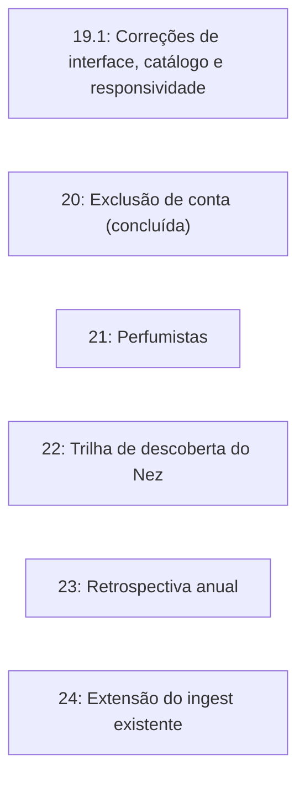

# Sillage — Roadmap de Evolução V2 (Fase 19.1 e Fases 20 a 24)

Este documento especifica as correções prioritárias e as fases seguintes de produto do Sillage. Foi auditado contra o código do `main` (commit 8969e84): o que já existe está marcado como concluído, e o que contradizia o código foi corrigido.

Todas as especificações seguem as regras do `AGENTS.md`:

- **Sem emojis na aplicação:** só tipografia e ícones da `lucide-react`.
- **Camadas:** `Page → Component → Hook → Service → Supabase` (só `services/` importa o cliente Supabase).
- **Segurança:** a autorização é a RLS; `service_role` só em Edge Function ou script administrativo.
- **Design system:** só tokens; contraste WCAG AA; animação só com `motion/react` (transform e opacity) e respeitando reduced motion.
- **Todo componente assíncrono** tem loading (skeleton), vazio, erro e offline.
- **Foco pessoal:** contemplação, enciclopédia olfativa e acervo privado; sem classificados ou trocas.

---

## Visão Geral



As fases não têm ordem obrigatória entre si; as dependências externas estão na matriz no fim. A 23 deve sair antes de dezembro de 2026.

---

## Fase 19.1: Correções de Interface, Catálogo e Responsividade

Entregue em três PRs: **19.1-a** (itens 4 e 5), **19.1-b** (item 3) e **19.1-c** (item 1 bloqueado; do item 2, o recorte da Boemia está feito).

### 1. Catálogo: fichas e imagens de 3 perfumes (19.1-c, bloqueado)

Hoje Amyi 2.15, Irish Green Man e Caipi d'Argent existem **só** em `supabase/dev/fake-perfumes-e2e.sql`, com notas de saída genéricas (`bergamota`, `lima`...) e sem fotos em `scripts/raw-images/`. Não são "stubs reais": os dados lá são de teste e não devem ser tratados como oficiais.

- **Fichas:** gerar com `npm run ingest` (o `scripts/ingest-perfume.mjs` já existe), revisar com `--dry-run` e fazer a curadoria de concentração, ano, perfumista, descrição em português e pirâmide completa antes de gravar no `supabase/seed.sql`. Os valores do arquivo fake (ex.: `edc` do Irish Green Man, sem fonte) **não** são fonte.
- **Marca Maison Condé:** o slug no arquivo fake está truncado (`maison-cond`); o correto é `maison-conde`.
- **Duplicidade:** ao entrarem no seed, remover os 3 do arquivo fake de E2E (ou trocar por slugs fictícios), para não haver slug duplicado, e conferir se algum E2E depende deles.
- **Pipeline de imagens:** `scripts/process-images.mjs` → `scripts/upload-images.mjs` (`npm run images:upload`) → SQL de `image_path` (`npm run images`).
- **Bloqueio:** as fotos originais são fornecidas pelo curador. Sem elas e sem as fichas revisadas, esta tarefa não avança.

### 2. Modo noturno: recorte dos frascos (Boemia feita; o resto bloqueado com o item 1)

- **Problema:** em fundo escuro (`--stage: #272e29`), Boemia (Granado) tem franjas claras nas bordas e uma mancha branca de sombra na base.
- **Feito (Boemia):** o merge em `scripts/image-overrides.json` mantém `bossa`, `gigi` e `bonissimo` e acrescenta `"boemia": { "tolerance": 14, "cropBottom": 0.22 }`. Os valores vieram de uma comparação lado a lado sobre o palco escuro (as mesmas funções do `process-images.mjs`): sem override, a mancha branca fica; `tolerance: 32` (valor do roadmap original) apaga o líquido e deixa o frasco oco; `tolerance: 14` com `cropBottom: 0.22` tira a mancha e mantém o líquido, ao custo de cortar a base de vidro. As franjas laterais do líquido (pálido como o fundo da foto) não saem só com os parâmetros: só uma foto de origem melhor ou um recorte manual resolve. A Bossa já estava boa com o override que tinha.
- **Para valer em produção:** rodar `npm run images` (gera o novo hash da Boemia), atualizar o `image_path` dela no `supabase/seed.sql` com o SQL que o comando imprime e rodar `npm run images:upload`. Nada disso foi feito: o seed e o Storage continuam com a versão antiga até lá.
- **Ainda bloqueado:** os overrides de `amyi-2-15`, `irish-green-man` e `caipi-argent` dependem das fotos originais, que só o curador tem; calibrar sem a foto seria chute.
- "Feathering" não é chave de override: é a constante fixa `EDGE_SMOOTHING = 0.8` em `process-images.mjs`. Se o recorte pedir, criar a chave opcional `edgeSmoothing`, com teste em `process-images.test.mjs`.

### 3. Widget de clima: nome real do local (19.1-b)

- **Problema:** com GPS permitido, o app mostra a string fixa "Sua localização".
- **Solução:** Open-Meteo segue como motor meteorológico. A geocodificação reversa da BigDataCloud (`https://api.bigdatacloud.net/data/reverse-geocode-client`) é chamada só quando há GPS.
- **Formato:** `{Bairro ou Cidade}, {UF}`, com `locality || city` e a UF extraída de `principalSubdivisionCode` ("BR-SP" → "SP"). Exemplos reais da API (conferidos): coordenadas de Moema devolvem `locality: "São Paulo"` e dão "São Paulo, SP"; as de Curitiba dão "Curitiba, PR". O campo `city` pode vir como região metropolitana ("Região Metropolitana de São Paulo"), por isso `locality` tem prioridade.
- **Falha da API:** cai no rótulo atual ("Sua localização").
- **Privacidade:** arredondar as coordenadas a 2 casas antes de enviar; registrar o envio a terceiro no `SECURITY.md`.
- `vercel.json`: incluir `https://api.bigdatacloud.net` no `connect-src`.
- Revisar `cityFromLabel` em `src/lib/sotdCard.ts`, que hoje só reconhece "Sua localização".
- Query key `['private', userId, 'geo', lat2, lon2]` (não persiste), com `staleTime` longo.

### 4. Memorial na Home: miniaturas reais (19.1-a)

- **Problema:** `DailyHistory.tsx` renderiza só o `PerfumePlaceholder`.
- **Solução:** `PerfumeStage` + `PerfumeImage` (variant thumb) quando houver imagem, com o placeholder como `fallback`. Referências: `MemorialCalendar.tsx` e `DailyHighlight.tsx`.

### 5. Responsividade a 360 px (19.1-a)

- **Problema:** `p-6` com botões de texto longo ("Adicione a Tenho para vestir") corta o conteúdo dentro do container com `overflow-hidden`.
- **Causa do `whitespace-nowrap`:** vem do `Button` base (`src/components/ui/button.tsx`), não do card. Não alterar o `Button` global.
- **Solução, só em `DailySuggestionCard.tsx`:** padding `p-4 sm:p-6 md:p-8` (conteúdo e skeleton); linha de botões `flex flex-col sm:flex-row`; botões `w-full sm:w-auto whitespace-normal`.
- **Testes:** Vitest do `DailyHistory` (com e sem imagem) e, em `e2e/home.spec.ts`, teste a 360 px com `scrollWidth <= clientWidth`.

---

## Fase 20: Exclusão de Conta — Concluída

Já implementada: Edge Function `delete-account` (que também remove o avatar), `DangerZone` com o diálogo que pede "EXCLUIR", `useDeleteAccount`, `authService.deleteAccount`, pgTAP `16_account_deletion` e E2E com a chamada simulada. Falta apenas o deploy manual: `npx supabase functions deploy delete-account`.

- **Cascata:** só `profiles` referencia `auth.users`; as demais tabelas (coleção, diário, resenhas) fazem cascata via `profiles`.
- **Cache local:** o IndexedDB nunca guarda dados privados (`['private', ...]` não persiste), então não precisa ser limpo.
- **Lacuna opcional:** E2E sem mock, contra o Supabase local: criar usuário efêmero, adicionar um item, excluir a conta e confirmar que o login falha depois.

---

## Fase 21: Perfumistas ("Os Narizes")

### 1. Escopo

Transformar o perfumista, hoje texto em `perfumes.perfumer`, em entidade navegável. Um perfume pode ter mais de um perfumista.

### 2. Modelo de dados

- **`perfumers`:** `id`, `name`, `slug` único (check `^[a-z0-9-]+$`), `bio`, `country`, `created_at`; checks de tamanho em `name` e `bio`.
- **`perfume_perfumers(perfume_id, perfumer_id, position)`:** PK composta, FKs com `on delete cascade`. (Em vez de uma coluna `perfumer_id` em `perfumes`.)
- **RLS:** select para `anon` e `authenticated`; insert/update/delete só com `is_admin()`.
- **Migração do texto:** backfill explícito a partir de `perfumes.perfumer` (sem `unaccent`); em migration seguinte, `drop column perfumer`.
- **Ajustes:** `perfumeService.ts`, `src/types/catalog.ts`, `database.types.ts` (regenerar) e o `ingest-perfume.mjs`, que hoje grava `perfumer` como texto.

### 3. Rotas e interface

- **Rota:** `perfumers/:slug` nos children do AppShell (`src/routes/router.tsx`). Query key `['public', 'perfumers', 'detail', slug]`.
- **`PerfumerDetailsPage`:** nome em Fraunces, país (ícone `Globe`), bio e grade de perfumes (reutiliza `PerfumeGrid`). Estados: skeleton, vazio, erro, offline e 404.
- **`PerfumeDetailsPage`:** o nome do perfumista vira link, com o ícone `Feather`.

### 4. Testes

pgTAP `18_perfumers.test.sql` (o 16 e o 17 estão ocupados): slug único, FK, leitura anon, escrita bloqueada para não-admin. Vitest da página. Docs: `DATABASE.md` e `PRODUCT.md` §12.

---

## Fase 22: Trilha de Descoberta do Nez

### 1. Escopo

O Nez passa de chat reativo a consultor ativo: o usuário responde um questionário curto e recebe até 3 perfumes **reais do catálogo**.

### 2. Fluxo (no `NezDrawer`)

1. **Clima:** automático (temperatura do `useWeather`, via `src/lib/climate.ts`) ou manual: frio (`Snowflake`), ameno (`Cloud`), calor (`Sun`).
2. **Ocasião:** `Briefcase` (trabalho), `Moon` (noite), `Sun` (casual), `Sparkles` (especial).
3. **Preferências:** 1 a 2 famílias, ou usar o próprio DNA olfativo.
4. **Resultado:** texto do Nez e até 3 cards de perfume com link para `/perfumes/:slug`.

### 3. Contrato com a Edge Function `nez-ai`

Hoje a função recebe `{question, context, history}`, não tem `mode`, não acessa o catálogo e o prompt dela proíbe citar perfumes. Novo contrato discriminado (o modo `chat` atual não muda):

```json
{
  "mode": "discovery",
  "climate": "cold | mild | hot",
  "occasion": "work | night | casual | special",
  "families": ["até 2 famílias olfativas"],
  "useDna": true
}
```

O DNA **não** vem do cliente. No servidor:

1. validar os enums;
2. se `useDna`, chamar `get_olfactory_dna()` com o cliente do usuário (JWT);
3. pré-selecionar ~12 candidatos de forma determinística no banco (RPC `get_discovery_candidates`, invoker, só `authenticated`);
4. chamar o Gemini com `responseJsonSchema` `{text, picks}`, `picks` sendo enum dos slugs candidatos (máx. 3);
5. conferir no servidor que `picks ⊆ candidatos` antes de responder;
6. o prompt de discovery só permite citar os candidatos.

### 4. Riscos e testes

- Sem rate limit (risco aceito em `SECURITY.md`); registrar que o discovery aumenta o custo por chamada.
- UI com loading, erro, offline e "sem candidatos".
- Vitest do hook e dos passos; teste de validação do payload na função.

---

## Fase 23: "Seu Ano em Perfumes" (Retrospectiva)

**Entregar antes de dezembro de 2026.**

### 1. Métricas (`get_annual_recap(p_year int) returns jsonb`)

Security invoker, `search_path = ''`, `revoke ... from public, anon`, grant para `authenticated`. Valida `p_year` entre 2026 e o ano atual. Calcula, sobre `daily_perfumes` do usuário:

- dias vestidos e consistência (dias vestidos ÷ dias decorridos do ano, no fuso do perfil);
- perfume assinatura;
- perfume mais usado por estação, com desempate determinístico;
- nota mais presente;
- peso das famílias no 1º e no 2º semestre (a "evolução do gosto"; o `get_olfactory_dna` não tem filtro de data, então o cálculo fica dentro da própria função).

**Estações (hemisfério Sul, meteorológicas):** Verão dez–fev, Outono mar–mai, Inverno jun–ago, Primavera set–nov. O Verão do ano N junta jan–fev e dez do mesmo ano civil.

### 2. Apresentação

- **Rota** `recap/:year`, com 404 para ano inválido e estado vazio abaixo de N dias registrados (sugestão: 7).
- **5 lâminas** com `motion/react` (transform e opacity) e reduced motion: ritmo do ano, assinatura, 4 estações, nota do ano, encerramento com ações.
- **Card 9:16 (1080×1920)** com ícone `Share2`. O canvas da 16B é específico do SOTD (`renderSotdCard`): extrair as primitivas genéricas (`wrapText`, `canvasToBlob`, fontes, ícones) de `src/lib/sotdCanvas.ts` para `src/lib/canvas.ts` e criar `renderRecapCard`, sem quebrar os testes do SOTD.
- **Dados:** `recapService` → `useAnnualRecap`, key `['private', userId, 'recap', year]`, schema Zod em `src/schemas/recap.ts`.

### 3. Testes

pgTAP `20_annual_recap` (o 18 é dos perfumistas e o 19 da trilha do Nez) (isolamento entre usuários, estações, ano sem dados) e Vitest das lâminas.

---

## Fase 24: Extensão do ingest existente

O `scripts/ingest-perfume.mjs` já faz a extração com Gemini, validação Zod, `responseJsonSchema`, `--dry-run` e tem testes. Esta fase **estende** esse script; não cria `ingest-ai.mjs`.

- **Entrada (feito):** além do nome, `--url` (baixa a página, tira o HTML e passa só o texto) e `--text` (texto bruto). Com fonte, o Gemini extrai **somente** dela (o que ela não disser fica `null` ou vazio) e o nome do perfume passa a ser opcional. O texto da fonte vai ao prompt como dado, nunca como instrução.
- **Imagem opcional (feito, com um desvio do plano original):** `--image <url>` baixa a foto para `scripts/raw-images/<marca>/<perfume>.<ext>` (tipos aceitos pelo `process-images`; nunca sobrescreve) e manda rodar `npm run images` e `npm run images:upload`. O `download-images.mjs` busca por nome no DuckDuckGo/Bing e não aceita URL, então não dá para encadeá-lo; o `process-images.mjs` processa tudo que está em `raw-images/`, por isso também não é disparado sozinho.
- **Modelo:** via `GEMINI_MODEL` (padrão `gemini-3.5-flash`). O `gemini-2.5-flash` não está mais disponível para contas novas.
- **Schema:** é o que o script já usa, alinhado ao banco: o banco **não** tem `families` nem `dominant_accord`; `release_year` aceita vazio; as notas são `[{name, family, position, description}]`.
- **Testes** (`scripts/ingest-perfume.test.mjs` e `scripts/ingest-extension.test.mjs`) com payloads simulados: JSON inválido, concentração fora do enum ou não confirmada, nota com família ou posição desconhecida, perfume sem nenhuma nota aproveitável e nome ou marca sem slug nunca geram SQL; uma descrição com tentativa de injeção fica dentro do literal.

---

## Fase 25: Login por Biometria / Passkeys (WebAuthn)

Especificação completa em [PLANO_PASSKEYS.md](PLANO_PASSKEYS.md).

- **Escopo:** Suporte a Face ID, Touch ID e Windows Hello via WebAuthn para usuários com conta confirmada.
- **Frontend:** `authService` com métodos de Passkey; hooks em `usePasskeys.ts`; botão "Entrar com Face ID ou Digital" em `LoginPage.tsx`; gestão de aparelhos em `ProfilePage.tsx` (`PasskeyManager.tsx`).
- **Segurança:** Autenticação FIDO2 criptográfica; chaves privadas protegidas em hardware; query key `['private', userId, 'passkeys']` nunca persistida.

---

## Matriz de Dependências

| Fase                        | Banco                | UI                   | Depende de                 | Benefício                            |
| :-------------------------- | :------------------- | :------------------- | :------------------------- | :----------------------------------- |
| **19.1 (Correções)**        | Baixa (seed)         | Média (CSS/mobile)   | Fotos e fichas (19.1-c)    | Bugs visuais e paridade de catálogo  |
| **20 (Exclusão de conta)**  | Concluída            | Concluída            | —                          | Conformidade e segurança             |
| **21 (Perfumistas)**        | Média (2 tabelas)    | Média                | —                          | Navegação relacional                 |
| **22 (Trilha do Nez)**      | Média (RPC + função) | Média                | Nez (Fase 10) e DNA (16A)  | Menos indecisão, mais engajamento    |
| **23 (Retrospectiva)**      | Média (função SQL)   | Alta                 | Memorial (19), 16B e DNA   | Retenção anual                       |
| **24 (Extensão do ingest)** | Baixa (tooling)      | Baixa (CLI)          | Ingest existente           | Crescimento do catálogo              |
| **25 (Passkeys / Face ID)** | Baixa (config Auth)  | Média (Login/Perfil) | Conta e e-mail confirmados | Acesso rápido sem senha (PWA nativo) |

---

## Entrega final v1.0.0

O fechamento da v1.0.0 segue `docs/PLANO_FINAL.md` (branch `release/v1.0.0`). Pendências manuais do mantenedor: configurar o SMTP no painel, cadastrar os perfumes nacionais com fonte e foto oficiais (2.1) e subir as imagens e as migrations em produção.
