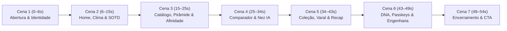

# Plano de Motion Design (LinkedIn Showcase) — Sillage

Este documento contém a arquitetura técnica, o roteiro cinematográfico cena a cena e as instruções completas de implementação para o **Claude Code** criar e renderizar o vídeo promocional do projeto **Sillage** para o LinkedIn.

---

## 1. Estratégia Técnica e Arquitetura do Vídeo

| Aspecto                    | Decisão                                                                                                     | Motivo                                                                                                                                                                                                                                                                 |
| :------------------------- | :---------------------------------------------------------------------------------------------------------- | :--------------------------------------------------------------------------------------------------------------------------------------------------------------------------------------------------------------------------------------------------------------------- |
| **Formato e Resolução**    | `1920×1080` (16:9 Full HD), `60 fps`, `H.264 (.mp4)`                                                        | Padrão ouro para vídeos widescreen no LinkedIn, permitindo exibir mockups Desktop (1280×800) e Mobile (390×844) lado a lado com altíssima nitidez.                                                                                                                     |
| **Duração**                | **54 segundos** (`3240 frames` a 60 fps)                                                                    | Ritmo dinâmico para retenção no feed do LinkedIn, com fade-in (1s) e fade-out suave (3s) na trilha `video/backgorund-music-video.mp3` (que tem 02:23 no total).                                                                                                        |
| **Abordagem Visual**       | **Híbrida (Playwright HiDPI + Remotion)**                                                                   | Capturas reais do Sillage rodando com `deviceScaleFactor: 2` (Retina/HiDPI) em temas Claro e Escuro + composição cinematográfica no **Remotion** com câmeras 2.5D, glassmorphism, tipografia oficial (`Fraunces` + `Inter`) e paleta exata do `src/styles/tokens.css`. |
| **Isolamento**             | Subprojeto em `video/` (`video/package.json`)                                                               | Não adiciona dependências ao app principal (`package.json` raiz permanece intocado, sem exigir mudanças em `docs/ARCHITECTURE.md`), e `eslint.config.js` ignora `video/**`.                                                                                            |
| **Git & Arquivos Pesados** | Ignorar `video/node_modules/`, `video/out/`, `video/public/`, `video/*.mp3` e `video/*.mp4` no `.gitignore` | Evita subir binários de áudio/vídeo e `node_modules` secundário para o repositório Git.                                                                                                                                                                                |

---

## 2. Roteiro Cinematográfico (Storyboard — 54s / 60fps / 3240 frames)



### Detalhamento das Cenas

1. **Cena 1 — Abertura Editorial (0s – 6s | Frames 0–360)**
   - Fundo creme (`#F6F4ED`) com fios sutis de rastro olfativo subindo (inspirado no `Footer` do Sillage).
   - Revelação da logo **Sillage** (`Fraunces` 600) + selo _"Enciclopédia olfativa & Acervo pessoal"_.
   - Entrada em perspectiva 2.5D da **Landing Page** (Desktop) acompanhada da tela de **Login com arte autoral e Passkey / Face ID** (Mobile), com transição suave do tema Claro (`#F6F4ED`) para o Escuro (`#0F1411`).

2. **Cena 2 — Home, Clima em Tempo Real & Perfume do Dia (6s – 15s | Frames 360–900)**
   - Destaque na **WeatherBar** ("Sillage recomendada para o clima de hoje") + **Sugestão do Dia** (alternância _Catálogo_ ⇄ _Meu armário_).
   - Zoom nos medidores de **Fixação**, **Rastro** e **Clima adequado**.
   - Ao lado, o card **Compartilhar dia (SOTD 9:16)** flutuando com moldura de vidro (`.glass`).

3. **Cena 3 — Catálogo, Pirâmide Olfativa Interativa & Afinidade (15s – 25s | Frames 900–1500)**
   - Visão do **Catálogo** com busca sem acentos (`unaccent` + `pg_trgm`) e chips coloridos das **10 famílias olfativas** nos tokens reais.
   - Transição para a **Página de Detalhes do Perfume**: destaque na **Pirâmide Olfativa** (Topo, Coração, Fundo), **FamilyBar** animada e o bloco **"Combina com você? — Afinidade Alta"** + link para a página de **Perfumistas ("Os Narizes")**.

4. **Cena 4 — Comparador Lado a Lado & Consultor Nez IA (25s – 34s | Frames 1500–2040)**
   - Split-screen mostrando o **Comparador (`/compare`)** lado a lado (Desktop e 360px) comparando pirâmide, famílias e adequação climática.
   - Entrada lateral da gaveta do **Nez (IA com Gemini)**: demonstração da **Trilha de Descoberta Guiada** (Clima + Ocasião + DNA → 3 perfumes reais validados no servidor).

5. **Cena 5 — Coleção (Formatos), Memorial em Varal & Retrospectiva (34s – 43s | Frames 2040–2580)**
   - **Coleção (`Tenho` / `Quero`)** exibindo os selos de formato (`Frasco 100 ml`, `Decant 10 ml`, `Amostra 2 ml`).
   - Destaque visual no **Memorial**: alternância entre a grade do **Calendário Mensal** e o **Varal de Memórias (`PolaroidLineCarousel`)** com as polaroids penduradas no fio que cede, acompanhado das lâminas do **"Seu Ano em Perfumes" (`/recap/:year`)**.

6. **Cena 6 — DNA Olfativo, Passkeys & Engenharia Full-Stack (43s – 49s | Frames 2580–2940)**
   - Tela de **Perfil** com o gráfico de **DNA Olfativo** e gerenciamento de **Passkeys (WebAuthn)**.
   - Bento Grid de **Engenharia & Qualidade** (focado em recrutadores e engenheiros no LinkedIn):
     - **Segurança no Banco:** PostgreSQL + RLS estrita (`auth.uid()`) + testes **pgTAP**.
     - **Arquitetura & Privacidade Offline:** PWA Workbox + cache segregado (`['public']` em IndexedDB vs `['private']` só em memória).
     - **Qualidade & Design System:** React 19 + TypeScript Strict + Tailwind 4 (100% tokens, WCAG AA automatizado) + Vitest + Playwright E2E + axe.

7. **Cena 7 — Encerramento (49s – 54s | Frames 2940–3240)**
   - Retorno calmo ao fundo editorial com a frase assinatura: _"Todo perfume deixa um rastro. O seu começa aqui."_
   - Wordmark **Sillage** + stack resumida no rodapé e fade-out sincronizado do áudio e vídeo.

---

## 3. Instruções de Execução para o Claude Code

### Divergências encontradas na spec

Nenhuma divergência encontrada na especificação (`docs/PRODUCT.md`, `docs/DESIGN_SYSTEM.md`, `docs/ARCHITECTURE.md`, `docs/ROADMAP_V2.md`). Esta tarefa cria um entregável audiovisual de portfólio isolado na pasta `video/`, sem alterar nenhuma regra de negócio, schema de banco, componente de produção ou dependência do `package.json` raiz.

### Contexto e Escopo

- **O que já está pronto:** A aplicação Sillage completa (Landing, Auth com Passkeys, Home com Clima e Sugestão do Dia, Card SOTD 9:16, Catálogo com filtros avançados, Detalhes com Pirâmide Olfativa e Afinidade, Perfumistas, Comparador lado a lado, Nez IA com chat e Trilha de Descoberta, Coleção com formatos Frasco/Decant/Amostra, Memorial em Calendário e Varal de Polaroids, Retrospectiva Anual e Perfil com DNA Olfativo).
- **Trilha sonora existente:** `video/backgorund-music-video.mp3` (já está na pasta `video/`, duração total 02:23).
- **Objetivo:** Criar um pipeline automatizado de captura de telas reais em alta definição (Playwright HiDPI) + um projeto Remotion isolado em `video/` que renderize o vídeo final `video/out/sillage-linkedin-showcase.mp4` (`1920x1080`, `60fps`, `54 segundos`, codec `h264`), com fade-in e fade-out na música.
- **O que NÃO entra:** Não adicionar pacotes no `package.json` da raiz; não alterar código em `src/**` nem em `supabase/**`; não commitar arquivos `.mp4`, `.mp3` ou capturas geradas no Git.

---

### Passo 0 — Inspeção Obrigatória

Primeiro **INSPECIONE** o estado atual do repositório (`git status`, conteúdo de `video/`, `src/styles/tokens.css`, `eslint.config.js`, `.gitignore` e rotas em `src/routes/router.tsx`) e me resuma o que encontrou antes de mexer.

---

### Tarefas Numeradas

#### Tarefa 1: Isolamento no ESLint e `.gitignore`

1. Em `eslint.config.js`, adicione `'video'` em `globalIgnores(['dist', 'node_modules', 'video'])` para que o ESLint da raiz não tente lintar o subprojeto Remotion com as regras do app.
2. Em `.gitignore`, adicione ao final uma seção para ignorar os artefatos pesados e dependências do vídeo:
   ```gitignore
   # Vídeo promocional (subprojeto Remotion e binários)
   video/node_modules/
   video/out/
   video/public/
   video/*.mp3
   video/*.mp4
   ```

#### Tarefa 2: Inicializar o subprojeto em `video/`

1. Crie `video/package.json` isolado (`"private": true`) e instale nele as versões atuais de:
   - `remotion`, `@remotion/cli`, `@remotion/renderer`, `@remotion/media-utils`, `@remotion/transitions`
   - `react`, `react-dom`, `@types/react`, `@types/react-dom`, `typescript`
   - `@fontsource/fraunces`, `@fontsource/inter`, `lucide-react`
     _(Verifique as versões atuais com `npm view` antes de instalar; não chute versões)._
2. Crie `video/tsconfig.json` e `video/remotion.config.ts`.
3. Copie (via script de setup ou preparação de build) o arquivo `video/backgorund-music-video.mp3` para `video/public/music.mp3` (para usar via `staticFile('music.mp3')` do Remotion) e as imagens estáticas necessárias (`public/favicon-32x32.png`, `public/auth-art/auth-art-1200.webp`).

#### Tarefa 3: Script de Captura Real em Alta Resolução (`video/scripts/capture-screens.mjs`)

Crie um script executável via Playwright (usando o Playwright já instalado na raiz e o Supabase local / Vite preview) que:

1. Garanta que o banco local tenha dados ricos para a demonstração:
   - Crie/autentique um usuário de demonstração com nome `"Helena Vasconcelos"`, adicione pelo menos 5 perfumes do catálogo em `"Tenho"` (com formatos detalhados: ex. `Frasco 100 ml`, `Decant 10 ml`, `Amostra 2 ml`) e 3 em `"Quero"`.
   - Registre entradas em `daily_perfumes` ao longo de vários dias do mês atual e de estações do ano para que o **DNA Olfativo**, o **Calendário do Memorial**, o **Varal de Memórias (`?vista=varal`)** e a **Retrospectiva Anual (`/recap/2026`)** apareçam populados e reais (nunca estados vazios).
   - Intercepte a chamada do Open-Meteo / geocoding se necessário para garantir clima estável (`22 °C · São Paulo, SP · Céu limpo`) e intercepte `**/functions/v1/nez-ai` para exibir uma recomendação impecável na Trilha de Descoberta do Nez.
2. Capture screenshots PNG em **HiDPI (`deviceScaleFactor: 2`)** tanto em Desktop (`1280×800`) quanto em Mobile (`390×844`), nos temas **Claro** e **Escuro**, salvando em `video/public/captures/`:
   - `01-landing-light-desktop.png` e `02-auth-login-mobile.png` (com botão de Passkey visível)
   - `03-home-light-desktop.png` (WeatherBar + Sugestão do Dia) e `04-home-dark-desktop.png`
   - `05-sotd-share-dialog.png` (Modal com o Card 9:16 gerado)
   - `06-catalog-light-desktop.png` (Catálogo filtrado com chips de famílias)
   - `07-perfume-detail-pyramid.png` (Hero + Pirâmide Olfativa + FamilyBar) e `08-perfume-affinity.png` (Bloco "Combina com você?" + Similares)
   - `09-compare-desktop.png` e `10-compare-mobile.png` (`/compare?a=...&b=...` com dois perfumes reais)
   - `11-nez-discovery-drawer.png` (Drawer do Nez aberto com resultado da Trilha de Descoberta)
   - `12-collection-owned.png` (Aba Tenho mostrando `FormatBadge` "Frasco 100 ml", "Decant 10 ml")
   - `13-memorial-calendar.png` (`/memorial` grade mensal) e `14-memorial-varal.png` (`/memorial?vista=varal` com `PolaroidLineCarousel`)
   - `15-recap-slide.png` (`/recap/2026` lâmina da retrospectiva)
   - `16-profile-dna-passkeys.png` (`/profile` mostrando Resumo, card **Seu DNA Olfativo** e **Login biométrico / Passkeys**)
3. Valide no próprio script que todos os arquivos PNG foram gerados e têm tamanho `> 20 KB` antes de prosseguir.

#### Tarefa 4: Design System e Componentes Cinematográficos no Remotion (`video/src/`)

1. Reproduza os tokens exatos de `src/styles/tokens.css` em `video/src/tokens.ts`:
   - Claro: `--background: #F6F4ED`, `--surface: #FFFFFF`, `--foreground: #17231C`, `--text-secondary: #4C5B52`, `--primary: #36694C`, `--accent: #E4EBE0`
   - Escuro: `--background: #0F1411`, `--surface: #181E1A`, `--foreground: #EEF3EC`, `--text-secondary: #B4C0B7`, `--primary: #86C9A2`, `--accent: #223028`
   - As 10 cores de famílias olfativas (`citrus`, `floral`, `woody`, `green`, `aquatic`, `oriental`, `spicy`, `fruity`, `aromatic`, `musky`).
2. Carregue `@fontsource/fraunces` (500, 600) e `@fontsource/inter` (400, 500, 600).
3. Crie molduras reutilizáveis de alta precisão:
   - `BrowserFrame`: janela desktop minimalista com barra superior de vidro, 3 pontos discretos, URL do Sillage (`sillage.app/...`), sombra suave e recorte arredondado.
   - `PhoneFrame`: moldura mobile elegante com cantos arredondados e sombra realista.
   - `FeatureCallout`: pílula flutuante em glassmorphism com ícone Lucide, título curto em `Fraunces` e legenda em `Inter` em português (`pt-BR`).
   - `SillageAmbientBg`: fundo com gradiente sutil e partículas/fios orgânicos lentos que remetem ao rastro do perfume.

#### Tarefa 5: Composição das 7 Cenas e Áudio (`1920x1080`, `60fps`, `3240 frames` = 54s)

Implemente a composição principal `SillageShowcase` usando `spring()` e `interpolate()` do Remotion (movimentos suaves, sem saltos bruscos):

- **Áudio:** Use `<Audio src={staticFile('music.mp3')} volume={(f) => ...} />` com fade-in nos primeiros 60 frames (1s), volume `0.85` durante o vídeo e fade-out suave nos últimos 180 frames (3s, de 51s a 54s).
- **Cena 1 (0–6s):** Intro editorial com logo + frase _"Enciclopédia olfativa & Acervo pessoal"_, seguida de entrada em perspectiva 2.5D da Landing (`01-landing-light-desktop.png`) e Login Mobile (`02-auth-login-mobile.png`), virando do tema Claro para o Escuro.
- **Cena 2 (6–15s):** Home Diária (`03-home-light-desktop.png` / `04-home-dark-desktop.png`) com pan/zoom suave para a `WeatherBar` e Sugestão do Dia, e entrada flutuante do modal `05-sotd-share-dialog.png` (Card 9:16).
- **Cena 3 (15–25s):** Catálogo (`06-catalog-light-desktop.png`) com destaque nos filtros e chips das 10 famílias → transição para Detalhes do Perfume (`07-perfume-detail-pyramid.png` e `08-perfume-affinity.png`), dando zoom na Pirâmide Olfativa e no bloco "Combina com você?".
- **Cena 4 (25–34s):** Comparador lado a lado (`09-compare-desktop.png` + `10-compare-mobile.png`) e abertura da gaveta do Consultor **Nez IA** (`11-nez-discovery-drawer.png`) destacando a recomendação guiada com Gemini.
- **Cena 5 (34–43s):** Coleção com formatos (`12-collection-owned.png`), seguida do **Memorial** alternando entre Calendário (`13-memorial-calendar.png`) e **Varal de Memórias** (`14-memorial-varal.png`), junto da **Retrospectiva Anual** (`15-recap-slide.png`).
- **Cena 6 (43–49s):** Perfil com **DNA Olfativo** e **Passkeys** (`16-profile-dna-passkeys.png`) ao lado de um **Bento Grid de Arquitetura & Qualidade** destacando:
  1. `PostgreSQL + RLS + pgTAP` (Privacidade garantida no banco)
  2. `PWA Offline-First` (Cache público em IndexedDB vs privado em memória)
  3. `Design System & QA` (Tokens WCAG AA, React 19, TypeScript Strict, Vitest, Playwright + axe)
- **Cena 7 (49–54s):** Outro calmo com a frase _"Todo perfume deixa um rastro. O seu começa aqui."_, logo **Sillage** e fade-out sincronizado com a música.

#### Tarefa 6: Renderização e Verificação de Qualidade

1. Adicione scripts em `video/package.json`:
   - `"capture": "node scripts/capture-screens.mjs"`
   - `"studio": "remotion studio"`
   - `"render": "remotion render src/index.ts SillageShowcase out/sillage-linkedin-showcase.mp4 --codec=h264 --crf=18"`
2. Execute `npm run capture` dentro de `video/`, confira as imagens geradas e depois execute `npm run render`.
3. Renderize também 4 frames estáticos de amostra (`remotion still`) das cenas principais para conferência visual rápida.

---

### Critério de Pronto (Exigido na Resposta Final)

Mostre a saída completa de todos os comandos abaixo na raiz do projeto (para provar que o Sillage continua 100% íntegro):

1. `npm run lint`
2. `npm run typecheck`
3. `npm run format:check`
4. `npm test`
5. `npm run build`
6. Verifique e mostre o tamanho, resolução e existência do arquivo final `video/out/sillage-linkedin-showcase.mp4`.

### Regras Finais

- Crie uma branch dedicada: `chore/linkedin-showcase-video`.
- Commits em Conventional Commits (apenas dos arquivos de configuração/código em `video/`, `.gitignore` e `eslint.config.js`; nunca commite `.mp4`, `.mp3` ou `video/public/`).
- Não faça commit nem push sem pedir permissão antes.
- Ao final, explique passo a passo como o usuário pode abrir o vídeo pronto no Windows Explorer para assistir e postar no LinkedIn, ou abrir o Remotion Studio caso queira ajustar algum texto.
